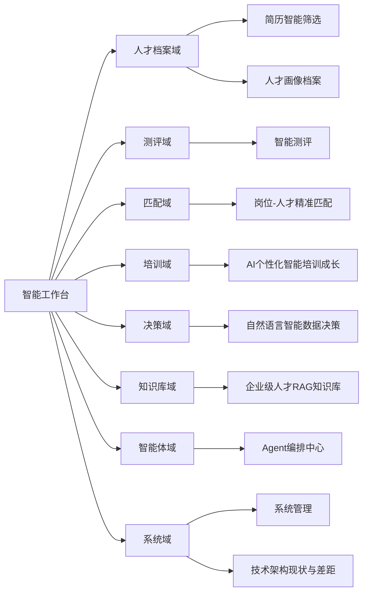

# AI 数字化人才平台 · 产品原型图（Prototype）

> **文档性质**：基于 PRD（`docs/PRD-2026-AI数字化人才平台.md`）与 DeepSeek 参考原型（`deepseek_html_20260927_8cefe4.html`）合并生成的产品原型，以 Markdown + 内嵌 HTML 线框呈现。
>
> - **视觉与交互稿**：直接取自 DeepSeek 参考原型（11 个页面线框、左侧导航、统计卡/图表样式）。
> - **需求与功能映射**：取自 PRD（需求 docx 与 `ai_talent` 仓库现状交叉比对），见文末"各页面对应 PRD 说明"。
> - **查看方式**：用支持 HTML 的 Markdown 预览（WorkBuddy 预览 / 浏览器 / Typora / VS Code 预览）打开，下方内嵌原型会以真实样式逐页渲染；若预览器不渲染 HTML，可改用文末 Mermaid 站点地图 + 文字说明理解结构。

---

## 1. 原型站点地图（Site Map）

---

## 2. 高保真线框原型（内嵌 HTML，逐页渲染）

以下为 11 个核心页面的高保真线框，直接由参考原型渲染

<aside class="sidebar">
    

      
AI

      

        
AI 数字化人才平台

        
AI 原生 · 企业级

      

    

    <nav class="nav">
      
概 览

      

        <svg viewBox="0 0 24 24" fill="none" stroke="currentColor" stroke-width="1.8" stroke-linecap="round" stroke-linejoin="round"><rect x="3" y="3" width="7" height="7" rx="1.6"/><rect x="14" y="3" width="7" height="7" rx="1.6"/><rect x="3" y="14" width="7" height="7" rx="1.6"/><rect x="14" y="14" width="7" height="7" rx="1.6"/></svg>
        智能工作台
      

      
AI 人才档案

      

        <svg viewBox="0 0 24 24" fill="none" stroke="currentColor" stroke-width="1.8" stroke-linecap="round" stroke-linejoin="round"><path d="M14 3H7a2 2 0 0 0-2 2v14a2 2 0 0 0 2 2h10a2 2 0 0 0 2-2V8z"/><path d="M14 3v5h5"/><path d="M9 13h6M9 17h4"/></svg>
        简历智能筛选
        <i class="nav-badge" style="font-style:normal">12</i>
      

      

        <svg viewBox="0 0 24 24" fill="none" stroke="currentColor" stroke-width="1.8" stroke-linecap="round" stroke-linejoin="round"><circle cx="12" cy="8" r="3.6"/><path d="M4.5 20a7.5 7.5 0 0 1 15 0"/></svg>
        人才画像档案
      

      
招聘与匹配

      

        <svg viewBox="0 0 24 24" fill="none" stroke="currentColor" stroke-width="1.8" stroke-linecap="round" stroke-linejoin="round"><circle cx="12" cy="12" r="8.5"/><circle cx="12" cy="12" r="3.6"/><path d="M12 1.5v3M12 19.5v3M1.5 12h3M19.5 12h3"/></svg>
        岗位-人才匹配
      

      

        <svg viewBox="0 0 24 24" fill="none" stroke="currentColor" stroke-width="1.8" stroke-linecap="round" stroke-linejoin="round"><rect x="4" y="3" width="16" height="18" rx="2.4"/><path d="M8.5 12.5l2.2 2.2 4.6-4.8"/></svg>
        智能测评
      

      
培训成长

      

        <svg viewBox="0 0 24 24" fill="none" stroke="currentColor" stroke-width="1.8" stroke-linecap="round" stroke-linejoin="round"><path d="M4 5.5A2.5 2.5 0 0 1 6.5 3H20v15H6.5A2.5 2.5 0 0 0 4 20.5z"/><path d="M4 20.5V5.5"/></svg>
        个性化培训
      

      
数据与知识

      

        <svg viewBox="0 0 24 24" fill="none" stroke="currentColor" stroke-width="1.8" stroke-linecap="round" stroke-linejoin="round"><path d="M4 20V10M10 20V4M16 20v-7M22 20H2"/></svg>
        智能问数
        <i class="nav-badge" style="font-style:normal;background:#8b5cf6">AI</i>
      

      

        <svg viewBox="0 0 24 24" fill="none" stroke="currentColor" stroke-width="1.8" stroke-linecap="round" stroke-linejoin="round"><ellipse cx="12" cy="6" rx="8" ry="3.2"/><path d="M4 6v12c0 1.8 3.6 3.2 8 3.2s8-1.4 8-3.2V6"/><path d="M4 12c0 1.8 3.6 3.2 8 3.2s8-1.4 8-3.2"/></svg>
        领域知识库
      

      
多智能体

      

        <svg viewBox="0 0 24 24" fill="none" stroke="currentColor" stroke-width="1.8" stroke-linecap="round" stroke-linejoin="round"><rect x="4" y="8" width="16" height="12" rx="3"/><path d="M12 4v4M9 14h.01M15 14h.01"/><path d="M2 13v3M22 13v3"/></svg>
        Agent 编排中心
      

      
系 统

      

        <svg viewBox="0 0 24 24" fill="none" stroke="currentColor" stroke-width="1.8" stroke-linecap="round" stroke-linejoin="round"><circle cx="12" cy="12" r="3"/><path d="M19.4 15a1.7 1.7 0 0 0 .34 1.87l.06.06a2 2 0 1 1-2.83 2.83l-.06-.06A1.7 1.7 0 0 0 15 19.4a1.7 1.7 0 0 0-1 1.55V21a2 2 0 1 1-4 0v-.05A1.7 1.7 0 0 0 9 19.4a1.7 1.7 0 0 0-1.87.34l-.06.06a2 2 0 1 1-2.83-2.83l.06-.06A1.7 1.7 0 0 0 4.6 15a1.7 1.7 0 0 0-1.55-1H3a2 2 0 1 1 0-4h.05A1.7 1.7 0 0 0 4.6 9a1.7 1.7 0 0 0-.34-1.87l-.06-.06a2 2 0 1 1 2.83-2.83l.06.06A1.7 1.7 0 0 0 9 4.6h.05A1.7 1.7 0 0 0 10 3.05V3a2 2 0 1 1 4 0v.05A1.7 1.7 0 0 0 15 4.6a1.7 1.7 0 0 0 1.87-.34l.06-.06a2 2 0 1 1 2.83 2.83l-.06.06A1.7 1.7 0 0 0 19.4 9v.05a1.7 1.7 0 0 0 1.55 1H21a2 2 0 1 1 0 4h-.05a1.7 1.7 0 0 0-1.55 1z"/></svg>
        系统管理
      

      

        <svg viewBox="0 0 24 24" fill="none" stroke="currentColor" stroke-width="1.8" stroke-linecap="round" stroke-linejoin="round"><path d="M12 3l9 5-9 5-9-5z"/><path d="M3 13l9 5 9-5"/></svg>
        技术架构现状
      

    </nav>

    

      

        
管

        

          
系统管理员

          
超级管理员 · 全部权限

        

      

    

  </aside>

<!-- ===== 页面 0 ===== -->
<section class="page active" id="page-dashboard">
        

          

            <h1>智能工作台</h1>
            
AI 原生人才智能平台 · 全流程智能化运营概览（数据截至 2026-09-27）

          

          

            <button class="btn">导出日报</button>
            <button class="btn primary">+ 发起 AI 任务</button>
          

        

        

          

            
<i class="dot blue"></i>在库人才档案

            
12,486人

            
↑ 8.2% 环比上月

          

          

            
<i class="dot cyan"></i>本月解析简历

            
3,254份

            
解析成功率 99.2%

          

          

            
<i class="dot amber"></i>待处理匹配任务

            
86项

            
12 项已超时预警

          

          

            
<i class="dot violet"></i>AI 调用量（本月）

            
128.6万次

            
覆盖 5 大 Agent · 平均 412ms

          

        

        

          

            

              <h3>五大智能体运行状态LangGraph 有状态工作流</h3>
              ● 全部在线
            

            

              
档案

              

                

                  档案解析 Agent
                  今日处理 428 份
                

                
<i style="width:92%"></i>

              

            

            

              
测评

              

                

                  测评分析 Agent
                  千人千卷 · 生成 156 套
                

                
<i style="width:78%"></i>

              

            

            

              
匹配

              

                

                  岗位匹配 Agent
                  平均匹配分 87.4
                

                
<i style="width:87%"></i>

              

            

            

              
培训

              

                

                  培训赋能 Agent
                  在学 1,204 人
                

                
<i style="width:64%"></i>

              

            

            

              
决策

              

                

                  数据决策 Agent
                  NL2SQL 引擎
                

                
<i style="width:71%"></i>

              

            

          

          

            

              <h3>人才缺口预警</h3>
              3 条待处理
            

            

              
34%

              

                
高级算法工程师

                
需求 26 人 · 在库匹配 9 人 · 缺口 17 人

              

              严重
            

            

              
61%

              

                
数据分析师（P6）

                
需求 18 人 · 在库匹配 11 人 · 缺口 7 人

              

              预警
            

            

              
76%

              

                
产品经理（AI 方向）

                
需求 12 人 · 在库匹配 9 人 · 缺口 3 人

              

              可控
            

            
※ 系统已自动向储备人才池推送 24 条岗位邀约，等待 HR 确认。

          

        

        

          

            
<h3>简历解析吞吐</h3>近 7 日

            

              

21

              

22

              

23

              

24

              

25

              

26

              

27

            

          

          

            
<h3>RAG 知识库问答量</h3>按角色

            
普通员工4,812 次

            
HR / 招聘2,306 次

            
业务负责人1,184 次

            
管理层642 次

            
回答溯源命中率96.7%

          

          

            
<h3>系统健康度</h3>正常

            
接口平均响应328 ms

            
向量检索时延186 ms

            
缓存命中率82%（目标 98%）

            
Celery 队列积压14 个任务

            
在线并发642 / 2000

          

        

      </section>
<!-- ===== 页面 1 ===== -->
<section class="page" id="page-resume">
        

          

            <h1>简历智能筛选</h1>
            
全格式解析（PDF / Word / 图片 / 扫描件）· 向量级标签画像 · 语义化检索 · 智能查重合并

          

          

            <button class="btn">批量导入</button>
            <button class="btn primary">+ 上传简历</button>
          

        

        

          

            

              
解析准确率（目标 ≥99%）

              
99.2<small>%</small>

              
<i style="width:99%"></i>

            

          

          

            

              
今日待解析队列

              
128<small>份</small>

              
<i style="width:46%"></i>

            

          

          

            

              
重复简历合并命中

              
37<small>组</small>

              
<i style="width:62%"></i>

            

          

        

        

          
<h3>筛选条件</h3><button class="btn sm">重置</button>

          

            全部岗位
            高级算法工程师
            数据分析师 P6
            AI 产品经理
            后端开发
          

          

            匹配分 ≥ 80
            已解析
            待人工复核
            985 / 211
            3 年以上经验
            已查重
          

        

        

          <table>
            <thead>
              <tr>
                <th style="width:30px"><input type="checkbox" /></th>
                <th>候选人</th>
                <th>应聘岗位</th>
                <th>匹配分</th>
                <th>核心标签</th>
                <th>解析状态</th>
                <th>操作</th>
              </tr>
            </thead>
            <tbody>
              <tr>
                <td><input type="checkbox" /></td>
                <td>
                  
陈 * 宇

                  
硕士 · 6 年经验 · 浙江大学

                </td>
                <td>高级算法工程师</td>
                <td>
                  

                    
94

                  

                </td>
                <td>LLM 微调 RAG PyTorch</td>
                <td>解析完成</td>
                <td><button class="btn sm">查看画像</button></td>
              </tr>
              <tr>
                <td><input type="checkbox" /></td>
                <td>
                  
李 * 婷

                  
本科 · 4 年经验 · 武汉大学

                </td>
                <td>数据分析师 P6</td>
                <td>
                  

                    
88

                  

                </td>
                <td>SQL 指标体系</td>
                <td>解析完成</td>
                <td><button class="btn sm">查看画像</button></td>
              </tr>
              <tr>
                <td><input type="checkbox" /></td>
                <td>
                  
王 * 峰

                  
硕士 · 8 年经验 · 清华大学

                </td>
                <td>AI 产品经理</td>
                <td>
                  

                    
76

                  

                </td>
                <td>B 端产品 AI 落地</td>
                <td>解析中 62%</td>
                <td><button class="btn sm">查看画像</button></td>
              </tr>
              <tr>
                <td><input type="checkbox" /></td>
                <td>
                  
赵 * 涵

                  
博士 · 3 年经验 · 上海交通大学

                </td>
                <td>高级算法工程师</td>
                <td>
                  

                    
91

                  

                </td>
                <td>多模态 CV</td>
                <td>扫描件 · 需复核</td>
                <td><button class="btn sm">人工校验</button></td>
              </tr>
            </tbody>
          </table>
        

        

          

            
<h3>文档解析链路</h3>

            
MinerU · 版式还原运行中

            
OpenCV · 照片识别运行中

            
PyPDF · 文本抽取运行中

            
Milvus · 向量化入库运行中

          

          

            
<h3>解析失败归因</h3>近 7 日

            
扫描件模糊14 份

            
非标准表格9 份

            
加密 PDF4 份

            
其他2 份

          

          

            
<h3>查重合并</h3>向量相似度

            
相似度 ≥0.95 自动合并21 组

            
0.85–0.95 待确认16 组

            
合并节省人工≈ 6.5 小时

          

        

      </section>
<!-- ===== 页面 2 ===== -->
<section class="page" id="page-talent">
        

          

            <h1>人才画像档案</h1>
            
百级标签体系 · 语义化自然语言检索 · 单/批量档案 RAG 问答

          

          

            <button class="btn">批量问答</button>
            <button class="btn primary">+ 新建档案</button>
          

        

        

          

            

              <h3>画像详情 · 陈 * 宇</h3>
              档案完整度 96%
            

            

              
陈

              

                
陈 * 宇

                
高级算法工程师 · 硕士 · 6 年经验 · 浙江大学

                

                  LLM 微调
                  RAG 架构
                  多模态
                  团队协作
                

              

            

            

              <svg width="230" height="220" viewBox="0 0 220 220">
                <polygon points="110,30 186,85 157,175 63,175 34,85" fill="#f8fafc" stroke="#e2e8f0" stroke-width="1"/>
                <polygon points="110,70 148,98 134,142 86,142 72,98" fill="none" stroke="#e8eef8" stroke-width="1"/>
                <polygon points="110,90 129,104 122,126 98,126 91,104" fill="none" stroke="#e8eef8" stroke-width="1"/>
                <line x1="110" y1="110" x2="110" y2="30" stroke="#e2e8f0" stroke-width="1"/>
                <line x1="110" y1="110" x2="186" y2="85" stroke="#e2e8f0" stroke-width="1"/>
                <line x1="110" y1="110" x2="157" y2="175" stroke="#e2e8f0" stroke-width="1"/>
                <line x1="110" y1="110" x2="63" y2="175" stroke="#e2e8f0" stroke-width="1"/>
                <line x1="110" y1="110" x2="34" y2="85" stroke="#e2e8f0" stroke-width="1"/>
                <polygon points="110,42 163,93 152,168 82,149 53,92"
                         fill="rgba(59,130,246,.20)" stroke="#3b82f6" stroke-width="2" stroke-linejoin="round"/>
                <circle cx="110" cy="42" r="3.5" fill="#3b82f6"/>
                <circle cx="163" cy="93" r="3.5" fill="#3b82f6"/>
                <circle cx="152" cy="168" r="3.5" fill="#3b82f6"/>
                <circle cx="82" cy="149" r="3.5" fill="#3b82f6"/>
                <circle cx="53" cy="92" r="3.5" fill="#3b82f6"/>
                <text x="110" y="18" text-anchor="middle" font-size="11" fill="#64748b">技术深度</text>
                <text x="199" y="84" text-anchor="middle" font-size="11" fill="#64748b">工程能力</text>
                <text x="167" y="194" text-anchor="middle" font-size="11" fill="#64748b">业务理解</text>
                <text x="53" y="194" text-anchor="middle" font-size="11" fill="#64748b">协作沟通</text>
                <text x="20" y="84" text-anchor="middle" font-size="11" fill="#64748b">学习潜力</text>
              </svg>
            

            

              全部标签 108
              技术栈 42
              项目经历 26
              软素质 21
              证书 19
            

          

          

            

              
<h3>档案 RAG 问答</h3>可溯源

              

                

                  
我

                  
这位候选人是否有大规模模型落地的完整经验？

                

                

                  
AI

                  

                    <b>结论：具备。</b>候选人在某头部互联网公司主导过 2 个 LLM 落地项目，覆盖<b>数据清洗 → 微调 → 推理优化 → 线上灰度</b>全链路，其中对话式客服模型日均调用量约 320 万次。
                    
1项目经历 · 2023.04–2024.11 · 主导角色

                    
2技能标签 · LLM 微调 / LoRA / vLLM 推理优化

                  

                

              

              

                <input placeholder="继续追问这位候选人的档案…" />
                <button class="btn primary sm">发送</button>
              

            

            

              
<h3>档案完整度分布</h3>

              
完整（≥90%）8,214 人

              
较完整（70–90%）3,102 人

              
待补充（&lt;70%）1,170 人

            

          

        

      </section>
<!-- ===== 页面 3 ===== -->
<section class="page" id="page-exam">
        

          

            <h1>智能测评</h1>
            
大模型自适应题库（千人千卷）· 全流程自动调度 · AI 能力结构分析 · 动态能力评级

          

          

            <button class="btn">题库管理</button>
            <button class="btn primary">+ 智能出卷</button>
          

        

        

          

            
<i class="dot blue"></i>题库总量

            
18,420题

            
覆盖 26 个技术方向

          

          

            
<i class="dot cyan"></i>本月生成试卷

            
1,086套

            
千人千卷 100% 生效

          

          

            
<i class="dot amber"></i>平均分

            
78.4分

            
↑ 3.1 分 环比

          

          

            
<i class="dot violet"></i>错题复盘覆盖率

            
92%

            
已生成复习计划 1,204 份

          

        

        

          

            
<h3>近期考核成绩</h3>自动研判

            <table>
              <thead>
                <tr><th>考生</th><th>试卷</th><th>得分</th><th>能力评级</th><th>状态</th></tr>
              </thead>
              <tbody>
                <tr>
                  <td class="cell-name">陈 * 宇</td>
                  <td>高级算法 · A 卷</td>
                  <td><b style="color:var(--ok)">94</b></td>
                  <td>A+ 优秀</td>
                  <td>已完成</td>
                </tr>
                <tr>
                  <td class="cell-name">李 * 婷</td>
                  <td>数据分析 · B 卷</td>
                  <td><b style="color:var(--ok)">88</b></td>
                  <td>A 良好</td>
                  <td>已完成</td>
                </tr>
                <tr>
                  <td class="cell-name">王 * 峰</td>
                  <td>AI 产品 · A 卷</td>
                  <td><b style="color:var(--warn)">71</b></td>
                  <td>B 待提升</td>
                  <td>已完成</td>
                </tr>
                <tr>
                  <td class="cell-name">赵 * 涵</td>
                  <td>高级算法 · C 卷</td>
                  <td><b>—</b></td>
                  <td>待研判</td>
                  <td>考试中 42%</td>
                </tr>
              </tbody>
            </table>
            
※ 系统按答题轨迹动态调节后续题目难度，实现"千人千卷"。

          

          

            
<h3>能力结构分析 · 陈 * 宇</h3>动态评级 A+

            

              <svg width="220" height="210" viewBox="0 0 220 220">
                <polygon points="110,30 186,85 157,175 63,175 34,85" fill="#f8fafc" stroke="#e2e8f0" stroke-width="1"/>
                <polygon points="110,70 148,98 134,142 86,142 72,98" fill="none" stroke="#e8eef8" stroke-width="1"/>
                <line x1="110" y1="110" x2="110" y2="30" stroke="#e2e8f0" stroke-width="1"/>
                <line x1="110" y1="110" x2="186" y2="85" stroke="#e2e8f0" stroke-width="1"/>
                <line x1="110" y1="110" x2="157" y2="175" stroke="#e2e8f0" stroke-width="1"/>
                <line x1="110" y1="110" x2="63" y2="175" stroke="#e2e8f0" stroke-width="1"/>
                <line x1="110" y1="110" x2="34" y2="85" stroke="#e2e8f0" stroke-width="1"/>
                <polygon points="110,38 170,90 150,172 76,158 42,88"
                         fill="rgba(139,92,246,.18)" stroke="#8b5cf6" stroke-width="2" stroke-linejoin="round"/>
                <text x="110" y="18" text-anchor="middle" font-size="11" fill="#64748b">算法理论</text>
                <text x="199" y="84" text-anchor="middle" font-size="11" fill="#64748b">工程落地</text>
                <text x="167" y="194" text-anchor="middle" font-size="11" fill="#64748b">系统设计</text>
                <text x="53" y="194" text-anchor="middle" font-size="11" fill="#64748b">数据处理</text>
                <text x="20" y="84" text-anchor="middle" font-size="11" fill="#64748b">业务抽象</text>
              </svg>
            

            
优势项算法理论 · 工程落地

            
待补强项业务抽象

            
推荐学习路径业务建模 12 课时

          

        

        

          

            
<h3>智能出卷配置</h3>

            
目标岗位高级算法工程师

            
难度分布易 30% / 中 50% / 难 20%

            
题量40 题 · 90 分钟

            
自适应难度已开启

          

          

            
<h3>AI 面试间</h3>进行中 6 场

            
今日排期24 场

            
平均时长32 分钟

            
面试评价生成自动

          

          

            
<h3>错题复盘</h3>Top 3 薄弱点

            
分布式训练调优错误率 46%

            
向量检索召回错误率 38%

            
Prompt 工程错误率 31%

          

        

      </section>
<!-- ===== 页面 4 ===== -->
<section class="page" id="page-match">
        

          

            <h1>岗位-人才精准匹配</h1>
            
岗位结构化解析 → 向量建模 · 0–100 匹配分 · 匹配原因可解释 · 岗位空缺预警与储备推荐

          

          

            <button class="btn">岗位条件配置</button>
            <button class="btn primary">+ 新建匹配任务</button>
          

        

        

          

            <h3>当前岗位：高级算法工程师（AI 平台部）</h3>
            缺口 17 人
          

          

            硕士及以上
            5 年以上
            LLM / RAG 经验
            PyTorch
            分布式训练
            顶会论文优先
          

        

        

          

            
<h3>匹配结果（按匹配分排序）</h3>共 42 位候选

            

              
94

              

                
陈 * 宇 · 硕士 · 6 年

                
LLM 微调 / RAG / 分布式训练 · 完全命中核心要求

              

              <button class="btn sm">查看</button>
            

            

              
91

              

                
赵 * 涵 · 博士 · 3 年

                
多模态 / CV / 顶会 3 篇 · 经验年限略低

              

              <button class="btn sm">查看</button>
            

            

              
85

              

                
孙 * 明 · 硕士 · 7 年

                
推荐系统 / 特征工程 · RAG 经验较弱

              

              <button class="btn sm">查看</button>
            

            

              
72

              

                
周 * 琳 · 本科 · 5 年

                
后端开发 / 高并发 · 算法经验不足

              

              <button class="btn sm">查看</button>
            

            

              
64

              

                
吴 * 涛 · 硕士 · 4 年

                
数据分析 / SQL · 岗位方向差异较大

              

              <button class="btn sm">查看</button>
            

          

          

            

              
<h3>匹配原因可解释</h3>陈 * 宇 · 94 分

              
技术栈匹配度96 / 100

              
经验年限匹配92 / 100

              
学历匹配100 / 100

              
行业背景匹配81 / 100

              
稳定性预测良好

              

                命中：LLM 微调（LoRA/QLoRA）、RAG 架构、vLLM 推理优化、分布式训练 
                缺口：缺少推荐系统与搜索排序经验（占比 8%）
              

            

            

              
<h3>岗位空缺预警 &amp; 储备推荐</h3>

              
空缺岗位数17

              
自动推荐储备人才24 人

              
已发出面试邀约9 人

              
预计闭环周期18 天

            

          

        

      </section>
<!-- ===== 页面 5 ===== -->
<section class="page" id="page-training">
        

          

            <h1>AI 个性化智能培训成长</h1>
            
能力缺口诊断 · 千人千面培训方案 · 学习全流程管控（防挂机）· 成长轨迹可视化

          

          

            <button class="btn">生成培训方案</button>
            <button class="btn primary">+ 新建课程</button>
          

        

        

          

            
<h3>能力缺口诊断 · 王 * 峰（AI 产品经理）</h3>3 项待补强

            

              

                大模型原理与能力边界42 / 100
              

              
<i style="width:42%"></i>

            

            

              

                AI 产品需求拆解61 / 100
              

              
<i style="width:61%"></i>

            

            

              

                数据指标设计68 / 100
              

              
<i style="width:68%"></i>

            

            

              

                跨部门协作与推动86 / 100
              

              
<i style="width:86%"></i>

            

            
※ 诊断结果由测评数据 + 岗位胜任力模型 + 上级评价三路融合生成。

          

          

            
<h3>AI 推荐培训方案</h3>千人千面

            

              
01

              

                
大模型原理与工程化落地

                
24 课时 · 视频 + 实操 · 预计 3 周

              

              必修
            

            

              
02

              

                
AI 产品需求拆解实战

                
16 课时 · 案例研讨 · 预计 2 周

              

              必修
            

            

              
03

              

                
数据指标体系设计

                
12 课时 · 工作坊 · 预计 1.5 周

              

              选修
            

            
完成全部必修后，系统将自动安排结业测评并更新能力画像。

          

        

        

          

            
<h3>课程进度</h3>在学 1,204 人

            
岗前培养方案328 人在学

            
培训课程726 人在学

            
复习计划150 人在学

            
平均完成率73%

          

          

            
<h3>学习全流程管控</h3>防挂机已开启

            
人脸抽检每 5 分钟

            
交互行为检测实时

            
今日异常告警6 次

            
学时有效性校验已启用

          

          

            
<h3>成长轨迹</h3>近 6 个月

            

              

4月

              

5月

              

6月

              

7月

              

8月

              

9月

            

            
<i style="background:#06b6d4"></i>能力综合指数

          

        

      </section>
<!-- ===== 页面 6 ===== -->
<section class="page" id="page-data">
        

          

            <h1>自然语言智能数据决策</h1>
            
口语化自由问数 · 自动多维分析 · 自动出图 · 一键生成 Word / PDF 报告 · 行/字段级权限联动

          

          

            <button class="btn">导出 Word</button>
            <button class="btn primary">导出 PDF 报告</button>
          

        

        

          

            

              
我

              
统计近 6 个月各事业部的招聘完成率与人均培训时长，做个对比

            

            

              
AI

              

                <b>已生成分析结果。</b>近 6 个月集团整体招聘完成率 82.4%，其中 <b>AI 平台事业部</b> 以 94.1% 领先，<b>智能制造事业部</b> 最低（68.3%）；人均培训时长整体呈上升趋势，9 月达到 12.6 小时 / 人。
                
SQL已生成并执行 · 权限范围：全集团（行级）· 耗时 1.8s

              

            

          

          

            

              
各事业部招聘完成率（%）

              

                

AI 平台

                

云服务

                

数字金融

                

智慧城市

                

智能制造

              

            

            

              
人均培训时长趋势（小时）

              

                

4月

                

5月

                

6月

                

7月

                

8月

                

9月

              

            

          

        

        

          

            <table>
              <thead>
                <tr><th>事业部</th><th>招聘完成率</th><th>人均培训时长</th><th>人才缺口</th></tr>
              </thead>
              <tbody>
                <tr><td class="cell-name">AI 平台事业部</td><td><b style="color:var(--ok)">94.1%</b></td><td>14.2 h</td><td>17 人</td></tr>
                <tr><td class="cell-name">云服务事业部</td><td><b style="color:var(--ok)">86.3%</b></td><td>12.8 h</td><td>8 人</td></tr>
                <tr><td class="cell-name">数字金融事业部</td><td>81.2%</td><td>11.6 h</td><td>6 人</td></tr>
                <tr><td class="cell-name">智慧城市事业部</td><td>74.5%</td><td>10.4 h</td><td>3 人</td></tr>
                <tr><td class="cell-name">智能制造事业部</td><td><b style="color:var(--warn)">68.3%</b></td><td>9.1 h</td><td>2 人</td></tr>
              </tbody>
            </table>
          

          

            

              
<h3>智能决策建议</h3>AI 生成

              
建议 1智能制造事业部招聘周期偏长，建议放宽学历硬条件

              
建议 2AI 平台事业部缺口最大，建议启用储备人才池直招

              
建议 3培训时长与招聘完成率正相关，建议加大培训投入

            

            

              
<h3>权限与合规</h3>已校验

              
当前角色管理层 · 全集团

              
行级权限已生效

              
字段级脱敏薪资字段已屏蔽

              
查询留痕已写入审计日志

            

          

        

        

          <input placeholder="用自然语言继续追问，例如：对比一下各事业部的离职率…" />
          <button class="btn primary">发送</button>
        

      </section>
<!-- ===== 页面 7 ===== -->
<section class="page" id="page-kb">
        

          

            <h1>企业级人才 RAG 智能问答知识库</h1>
            
100% 私有化部署 · 精准无幻觉可溯源 · 分级权限问答（员工 / HR / 管理层）

          

          

            <button class="btn">知识库管理</button>
            <button class="btn primary">+ 导入文档</button>
          

        

        

          

            

              <h3>知识问答</h3>
              

                员工级
                HR 级
                管理层
              

            

            

              

                
我

                
研发序列 P6 晋升到 P7，需要满足哪些条件？

              

              

                
AI

                

                  根据《研发序列职级晋升管理办法（2026 修订版）》，P6 → P7 需同时满足以下条件： 
                  <b>1. 任职年限：</b>P6 岗位任职满 2 年； 
                  <b>2. 绩效要求：</b>近 2 年绩效至少 1 次 A、且无 C； 
                  <b>3. 能力评估：</b>通过晋升答辩，技术深度与系统设计维度达到 L3 标准； 
                  <b>4. 项目贡献：</b>主导过至少 1 个跨团队重点项目。
                  
1《研发序列职级晋升管理办法（2026 修订版）》第 3.2 节

                  
2《技术能力评估标准》第 2 章 · L3 能力项定义

                

              

              

                
我

                
如果绩效差一点点，有没有特批通道？

              

              

                
AI

                

                  <b>存在。</b>办法第 4.1 条规定：对承担关键攻坚任务或拥有核心专利的员工，可由部门负责人发起"特批晋升"，需经技术委员会 2/3 以上成员同意。
                  
1《研发序列职级晋升管理办法（2026 修订版）》第 4.1 节

                

              

            

            

              <input placeholder="输入你的问题，例如：年假怎么计算？" />
              <button class="btn primary sm">发送</button>
            

          

          

            

              
<h3>知识库底座</h3>私有化

              
向量库Milvus · 2,486 万向量

              
知识图谱Neo4j · 增强溯源

              
文档总量12,840 份

              
检索时延186 ms

              
回答溯源命中率96.7%

            

            

              
<h3>幻觉抑制与安全护栏</h3>AI Safety

              
无引用不回答已开启

              
敏感词拦截已开启

              
越权访问拦截今日 14 次

              
回答置信度阈值≥ 0.82

            

            

              
<h3>分级权限</h3>

              
普通员工制度 / 政策 / 流程

              
HR / 招聘+ 薪酬带宽 / 编制

              
管理层+ 组织诊断 / 决策建议

            

          

        

      </section>
<!-- ===== 页面 8 ===== -->
<section class="page" id="page-agent">
        

          

            <h1>Agent 编排中心</h1>
            
五大专属 Agent · LangGraph 有状态工作流 · 可视化编排 · 多样化触发 · 统一中台管控

          

          

            <button class="btn">任务调度</button>
            <button class="btn primary">+ 新建智能体</button>
          

        

        

          

            
档案

            
档案解析 Agent

            
多格式解析 · 标签抽取 · 查重合并

            ● 已发布
          

          

            
测评

            
测评分析 Agent

            
自适应出题 · 能力研判 · 错题复盘

            ● 已发布
          

          

            
匹配

            
岗位匹配 Agent

            
向量建模 · 匹配打分 · 原因解释

            ● 已发布
          

          

            
培训

            
培训赋能 Agent

            
缺口诊断 · 方案生成 · 学习管控

            ● 灰度中
          

        

        

          

            <h3>可视化编排画布拖拽节点 · 连线编排 · 支持条件分支</h3>
            

              <button class="btn sm">保存</button>
              <button class="btn sm primary">试运行</button>
            

          

          

            <svg class="flow-lines" viewBox="0 0 1000 400" preserveAspectRatio="none">
              <defs>
                <marker id="arw" markerWidth="8" markerHeight="8" refX="7" refY="4" orient="auto">
                  <path d="M0,0 L8,4 L0,8 z" fill="#c3cee0"/>
                </marker>
              </defs>
              <path d="M190,200 L240,200" stroke="#c3cee0" stroke-width="2" fill="none" marker-end="url(#arw)" vector-effect="non-scaling-stroke"/>
              <path d="M390,200 L440,200" stroke="#c3cee0" stroke-width="2" fill="none" marker-end="url(#arw)" vector-effect="non-scaling-stroke"/>
              <path d="M590,200 L640,110" stroke="#c3cee0" stroke-width="2" fill="none" marker-end="url(#arw)" vector-effect="non-scaling-stroke"/>
              <path d="M590,200 L640,290" stroke="#c3cee0" stroke-width="2" fill="none" marker-end="url(#arw)" vector-effect="non-scaling-stroke"/>
              <path d="M790,110 L840,200" stroke="#c3cee0" stroke-width="2" fill="none" marker-end="url(#arw)" vector-effect="non-scaling-stroke"/>
              <path d="M790,290 L840,200" stroke="#c3cee0" stroke-width="2" fill="none" marker-end="url(#arw)" vector-effect="non-scaling-stroke"/>
            </svg>

            
简历上传<em>触发节点</em>

            
MinerU 解析<em>文档处理</em>

            
向量化入库<em>Milvus</em>

            
岗位匹配 Agent<em>打分 + 解释</em>

            
测评分析 Agent<em>能力研判</em>

            
输出决策<em>通知 / 报告</em>

          

          

            <i style="background:#e6f0ff;border:1px solid #93c5fd"></i>AI 处理节点
            <i style="background:#f1ebff;border:1px solid #c4b5fd"></i>智能体节点
            <i style="background:#fff;border:1px solid #dbe4f3"></i>通用节点
          

        

        

          

            
<h3>任务调度</h3>Celery 运行中

            
排队任务14

            
执行中6

            
今日完成2,486

            
失败重试3

          

          

            
<h3>数字员工</h3>7×24

            
数字机器人12 个

            
数字员工任务86 项 / 日

            
替代人工时长≈ 42 h / 日

          

          

            
<h3>模型供应商</h3>中台

            
已接入模型6 个

            
主推理模型私有化部署

            
Token 消耗（本月）2,148 万

          

        

      </section>
<!-- ===== 页面 9 ===== -->
<section class="page" id="page-system">
        

          

            <h1>系统管理</h1>
            
用户 / 部门 / 角色 / 菜单 / 日志 · 精细化多级权限（角色 · 行级 · 字段级）

          

          

            <button class="btn">操作日志</button>
            <button class="btn primary">+ 新增用户</button>
          

        

        

          
用户管理

          
角色与权限

          
审计日志

        

        

          

            <table>
              <thead>
                <tr><th>姓名</th><th>部门</th><th>角色</th><th>数据权限范围</th><th>状态</th><th>操作</th></tr>
              </thead>
              <tbody>
                <tr>
                  <td>
系统管理员

admin@corp.com
</td>
                  <td>信息技术部</td>
                  <td>超级管理员</td>
                  <td>全集团 · 全字段</td>
                  <td>正常</td>
                  <td><button class="btn sm">编辑</button></td>
                </tr>
                <tr>
                  <td>
张 * 敏

zhangm@corp.com
</td>
                  <td>人力资源部</td>
                  <td>HR 管理员</td>
                  <td>本部门 · 薪资脱敏</td>
                  <td>正常</td>
                  <td><button class="btn sm">编辑</button></td>
                </tr>
                <tr>
                  <td>
刘 * 强

liuq@corp.com
</td>
                  <td>AI 平台事业部</td>
                  <td>业务负责人</td>
                  <td>本事业部 · 部分字段</td>
                  <td>正常</td>
                  <td><button class="btn sm">编辑</button></td>
                </tr>
                <tr>
                  <td>
陈 * 宇

cheny@corp.com
</td>
                  <td>AI 平台事业部</td>
                  <td>普通员工</td>
                  <td>仅本人数据</td>
                  <td>正常</td>
                  <td><button class="btn sm">编辑</button></td>
                </tr>
                <tr>
                  <td>
吴 * 涛

wut@corp.com
</td>
                  <td>数据智能部</td>
                  <td>普通员工</td>
                  <td>仅本人数据</td>
                  <td>已停用</td>
                  <td><button class="btn sm">编辑</button></td>
                </tr>
              </tbody>
            </table>
          

        

        

          

            

              
<h3>角色：HR 管理员</h3>12 人

              
功能权限简历 / 岗位 / 测评 / 培训

              
行级权限本部门及下级

              
字段级权限薪资字段脱敏

              
数据导出允许（含水印）

            

            

              
<h3>角色：业务负责人</h3>36 人

              
功能权限岗位匹配 / 缺口 / 培训

              
行级权限本事业部

              
字段级权限联系方式脱敏

              
数据导出需审批

            

            

              
<h3>角色：普通员工</h3>8,420 人

              
功能权限知识问答 / 测评 / 学习

              
行级权限仅本人

              
字段级权限全部脱敏

              
数据导出禁止

            

          

        

        

          

            <table>
              <thead>
                <tr><th>时间</th><th>操作人</th><th>操作类型</th><th>对象</th><th>结果</th></tr>
              </thead>
              <tbody>
                <tr><td>2026-09-27 14:32</td><td>张 * 敏</td><td>批量导出简历</td><td>高级算法工程师 · 42 份</td><td>成功</td></tr>
                <tr><td>2026-09-27 14:18</td><td>系统</td><td>AI 调用</td><td>岗位匹配 Agent · 批次 #2486</td><td>成功</td></tr>
                <tr><td>2026-09-27 13:56</td><td>吴 * 涛</td><td>越权访问</td><td>薪酬带宽表</td><td>已拦截</td></tr>
                <tr><td>2026-09-27 11:20</td><td>刘 * 强</td><td>智能问数</td><td>本事业部招聘完成率</td><td>成功</td></tr>
                <tr><td>2026-09-27 10:04</td><td>系统管理员</td><td>修改角色权限</td><td>HR 管理员 · 字段级</td><td>成功</td></tr>
              </tbody>
            </table>
          

        

      </section>
<!-- ===== 页面 10 ===== -->
<section class="page" id="page-stack">
        

          

            <h1>技术架构现状与差距</h1>
            
需求强制技术栈 vs 仓库实际落地 · 偏差等级与决策建议（截至 2026-09-27）

          

          

            <button class="btn">导出对比报告</button>
          

        

        

          

            
<i class="dot green"></i>已完全落地

            
5项

            
FastAPI / SQLAlchemy / MySQL / Milvus / LangGraph

          

          

            
<i class="dot amber"></i>部分落地 / 待确认

            
2项

            
Redis（缺统一缓存层）/ LangChain

          

          

            
<i class="dot red"></i>未引入（需决策）

            
3项

            
PgSQL / Dify / Vanna.ai

          

          

            
<i class="dot violet"></i>超需求额外引入

            
7项

            
Neo4j / MinIO / MinerU / OpenCV / Celery 等

          

        

        

          <table>
            <thead>
              <tr><th>需求强制组件</th><th>当前代码状态</th><th>偏差等级</th><th>建议</th></tr>
            </thead>
            <tbody>
              <tr>
                <td class="cell-name">FastAPI</td>
                <td>✅ 已用（fastapi ≥ 0.115）</td>
                <td>无</td>
                <td>保持</td>
              </tr>
              <tr>
                <td class="cell-name">ORM（SQLAlchemy）</td>
                <td>✅ 已用（sqlalchemy ≥ 2.0，dao / infrastructure 分层）</td>
                <td>无</td>
                <td>保持，持续排查裸 SQL</td>
              </tr>
              <tr>
                <td class="cell-name">MySQL</td>
                <td>✅ 已用（pymysql，业务主数据）</td>
                <td>无</td>
                <td>保持</td>
              </tr>
              <tr>
                <td class="cell-name">Milvus</td>
                <td>✅ 已用（pymilvus ≥ 3.0，向量检索）</td>
                <td>无</td>
                <td>保持</td>
              </tr>
              <tr>
                <td class="cell-name">LangGraph</td>
                <td>✅ 已用（langgraph ≥ 0.2，langgraph_engine）</td>
                <td>无</td>
                <td>保持</td>
              </tr>
              <tr>
                <td class="cell-name">Redis</td>
                <td>⚠️ 经 celery[redis] 用于任务调度；缺统一缓存 / 会话 / 限流层</td>
                <td>中</td>
                <td>显式引入 Redis 作为缓存与会话 / 限流中间件，满足热点命中 ≥98%</td>
              </tr>
              <tr>
                <td class="cell-name">PgSQL</td>
                <td>❌ 未引入，海量分析 / 时序数据目前落在 MySQL</td>
                <td>高</td>
                <td>决策：是否引入 PgSQL 做分析宽表 / 时序（Vanna 类问数更稳）</td>
              </tr>
              <tr>
                <td class="cell-name">Dify</td>
                <td>❌ 未引入，以自研 agent_management / publish / workflow / model_provider 替代</td>
                <td>高</td>
                <td>决策：自研中台是否作为长期方案（推荐）；或集成 Dify 做可视化 Prompt / 编排</td>
              </tr>
              <tr>
                <td class="cell-name">Vanna.ai</td>
                <td>❌ 未引入，data-decision 模块承载 NL2SQL，引擎未确认</td>
                <td>高</td>
                <td>决策：是否基于 Vanna.ai 或自研 NL2SQL；需补"自动出图 / 出报告"能力</td>
              </tr>
              <tr>
                <td class="cell-name">LangChain</td>
                <td>⚠️ 未直接声明；langgraph 通常随带 langchain-core</td>
                <td>低</td>
                <td>确认依赖树；如需显式 LLM 编排可补 langchain</td>
              </tr>
            </tbody>
          </table>
        

        

          

            
<h3>非功能性指标达标评估</h3>待压测验证

            
并发在线 ≥2000 人架构支持 · 压测缺失

            
页面渲染 ≤1s待实测

            
向量检索 ≤500ms当前 186ms

            
普通接口 ≤1s当前 328ms

            
缓存命中率 ≥98%当前 82%

            
全年可用率 ≥99.9%待建设高可用部署

            
国产化适配未验证

          

          

            
<h3>待确认 / 风险清单</h3>7 项

            

              Q1
              
Dify 是否回填？自研中台功能面已覆盖，是否仍需可视化 Prompt / 编排？

            

            

              Q2
              
Vanna.ai 是否回填？NL2SQL 引擎归属与"自动出图 / 出报告"深度？

            

            

              Q3
              
PgSQL 是否引入？海量分析 / 时序数据是否继续留在 MySQL？

            

            

              Q4
              
Redis 专项缓存层缺失，热点命中率 ≥98% 如何保障？

            

            

              Q5
              
行 / 字段级权限是否已在所有查询接口落地？

            

            

              Q6
              
量化指标（解析 / 检索 / 匹配准确率）尚无评测集与基线。

            

            

              Q7
              
国产化适配：当前 MySQL / Milvus 非国产，政企场景是否需替换？

            

          

        

      </section>

---

## 3. 各页面对应 PRD 说明（设计要点与差距）

### 页面 0. 智能工作台
- **对应 PRD**：PRD 1.3 角色 / 2.7 多智能体 / 2.5 数据决策入口
- **设计要点**
  - 面向管理层/HR/管理员的一站式驾驶舱；
  - 五大智能体运行状态（LangGraph 有状态工作流）呼应 PRD 2.7；
  - 人才缺口预警、简历解析吞吐、RAG 问答量、系统健康度四类指标卡，对应 PRD 2.3/2.1/2.6 的运营口径。
### 页面 1. 简历智能筛选
- **对应 PRD**：PRD 2.1 AI 智能人才档案与数字画像
- **设计要点**
  - 筛选条件面板对应需求"语义化自然语言检索 + 结构化筛选"；
  - 文档解析链路（MinerU+OpenCV+PyPDF）可视化，对应仓库解析链路；
  - 解析失败归因、查重合并呼应需求"智能查重合并"（交互闭环需测试数据校验，见 PRD ⚠️）。
### 页面 2. 人才画像档案
- **对应 PRD**：PRD 2.1
- **设计要点**
  - 百级标签画像、档案完整度分布对应需求"向量级百级标签画像"；
  - 档案 RAG 问答对应"单/批量档案 RAG 问答"（需可溯源测试，见 PRD ⚠️）。
### 页面 3. 智能测评
- **对应 PRD**：PRD 2.2 AI 智能测评与能力研判
- **设计要点**
  - 能力雷达图对应"能力结构分析 / 动态能力评级"；
  - 智能出卷配置对应"大模型自适应题库（千人千卷）"（算法深度需代码复核，见 PRD ⚠️）；
  - AI 面试间、错题复盘已在仓库前端落地。
### 页面 4. 岗位-人才精准匹配
- **对应 PRD**：PRD 2.3
- **设计要点**
  - 0–100 匹配分排序、匹配原因可解释对应需求"匹配分（≥90%）+ 可解释"；
  - 岗位空缺预警 & 储备推荐对应"空缺预警与储备推荐"（是否闭环需确认，见 PRD ⚠️）。
### 页面 5. AI 个性化智能培训成长
- **对应 PRD**：PRD 2.4
- **设计要点**
  - 能力缺口诊断、AI 推荐方案对应"能力缺口诊断 + 千人千面方案"；
  - "学习全流程管控（防挂机）"对应需求强管控逻辑，需确认后端学时校验（PRD ⚠️）；
  - 成长轨迹可视化对应"成长轨迹可视化"。
### 页面 6. 自然语言智能数据决策
- **对应 PRD**：PRD 2.5（Vanna.ai 核心，存在偏差）
- **设计要点**
  - 口语化自由问数、智能决策建议对应需求"自然语言问数 + 决策建议"；
  - 权限与合规对应"行/字段级权限联动"；
  - ⚠️ 差距：仓库未引入 Vanna.ai，NL2SQL 引擎归属待确认，自动出图/出报告深度需重点确认（PRD 第 4 节）。
### 页面 7. 企业级人才 RAG 智能问答知识库
- **对应 PRD**：PRD 2.6
- **设计要点**
  - 知识问答 + 知识库底座（Milvus 向量 + Neo4j 图谱）对应需求；
  - 幻觉抑制与安全护栏、分级权限对应"精准无幻觉可溯源 + 分级权限"（需评测集验证，见 PRD ⚠️）。
### 页面 8. Agent 编排中心
- **对应 PRD**：PRD 2.7
- **设计要点**
  - 可视化编排画布（拖拽节点/连线/条件分支）对应"可视化编排"；
  - 任务调度、数字员工、模型供应商对应仓库 agent_management/agent_publish/agent_workflow/model_provider；
  - ⚠️ 差距：需求指定 Dify 中台，当前以自研中台替代，是否回填需决策（PRD 第 4 节）。
### 页面 9. 系统管理
- **对应 PRD**：PRD 2.8
- **设计要点**
  - 角色视图（HR 管理员 / 业务负责人 / 普通员工）对应"精细化多级权限"；
  - 行/字段级权限、操作日志对应"全操作日志与 AI 调用日志留痕"（是否贯穿所有查询需逐接口确认，见 PRD ⚠️）。
### 页面 10. 技术架构现状与差距
- **对应 PRD**：PRD 第 3–4 / 7 / 10 节
- **设计要点**
  - 非功能性指标达标评估表对应 PRD 第 7 节；
  - 待确认 / 风险清单对应 PRD 第 10 节（Dify/Vanna/PgSQL/Redis 四大决策）。

---

## 4. 原型覆盖的功能模块（对照 PRD 第 2 节）

| PRD 模块 | 原型页面 | 覆盖 |
|---|---|---|
| 2.1 AI 智能人才档案 | 智能工作台 / 简历智能筛选 / 人才画像档案 | ✅ 高 |
| 2.2 AI 智能测评 | 智能测评 | ✅ 高 |
| 2.3 岗位-人才匹配 | 岗位-人才精准匹配 | ✅ 高 |
| 2.4 个性化培训 | AI 个性化智能培训成长 | ✅ 中高 |
| 2.5 自然语言数据决策 | 自然语言智能数据决策 | ⚠️ 中（Vanna.ai 未回填） |
| 2.6 RAG 知识库 | 企业级人才 RAG 知识库 | ✅ 高 |
| 2.7 多智能体 / Skills | Agent 编排中心 / 智能工作台 | ✅ 高（Dify 未回填） |
| 2.8 权限安全 | 系统管理 | ✅ 高 |

## 5. 已知差距与待决策（详见 PRD 第 4 / 10 节）

- **Dify**：需求强制，当前以自研 agent_management/agent_publish/agent_workflow/model_provider 替代 → 是否回填？
- **Vanna.ai**：需求核心 NL2SQL，当前 data-decision 引擎未确认 → 是否回填？
- **PgSQL / Redis**：需求"四库协同"，当前 MySQL 单库 + Celery 侧 Redis → 是否引入分析库与统一缓存层？
- 量化指标（解析/检索/匹配准确率、时延）尚无评测集基线，原型中的指标数值为示意，需以真实数据校验。

---

*生成说明：原型线框取自 DeepSeek 参考 HTML（11 页 + 侧边导航 + 样式表）；需求映射与差距说明取自 PRD 及仓库现状（navigation.tsx / main.py / pyproject.toml / infrastructure 模型），状态截至 2026-09-27。*
