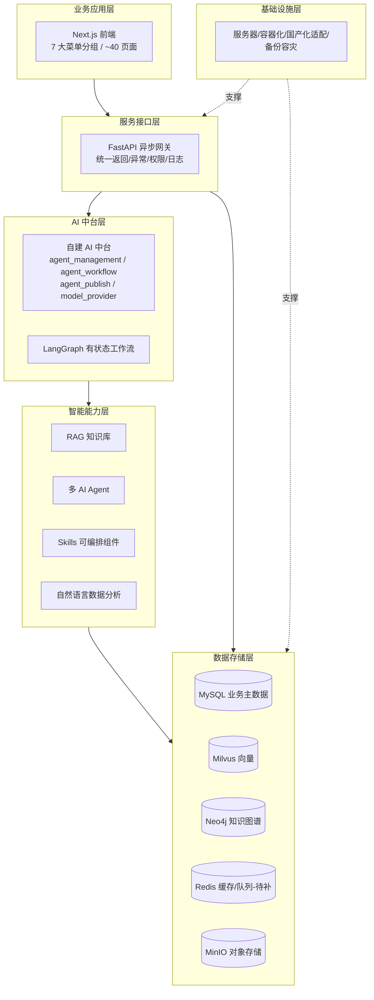
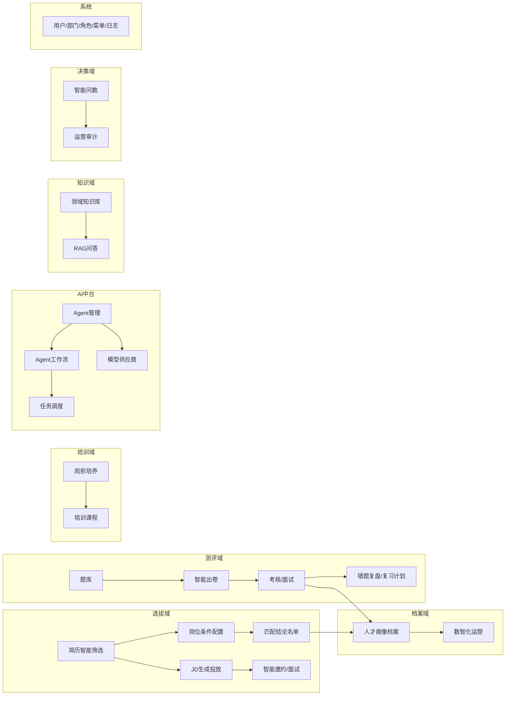
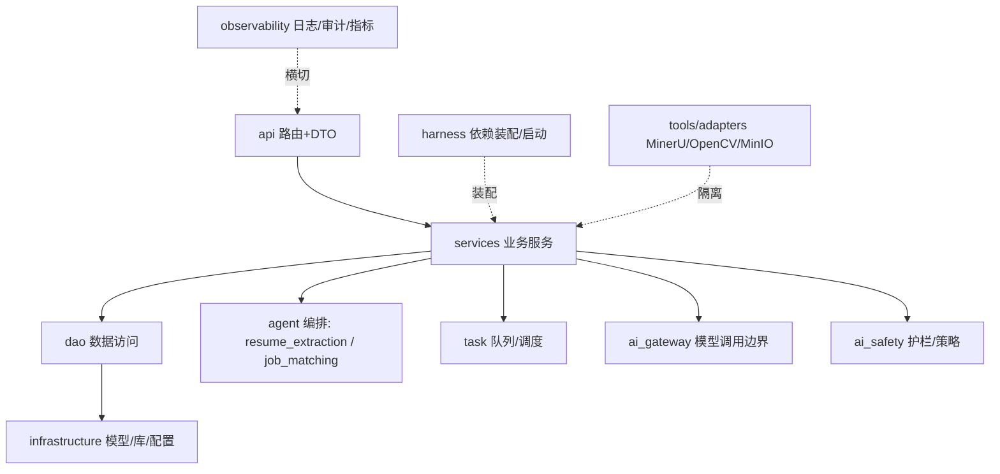

# 概要设计 · 2026 AI 数字化人才平台

> 配套文档：本文档依据 `docs/PRD-2026-AI数字化人才平台.md` 产出，描述系统级技术方案与模块边界。
> 现状依据：`frontend/src/app/navigation.tsx`、`backend/app/main.py`（28 路由）、`backend/pyproject.toml`、`backend/app/infrastructure/*`（ORM 模型），截至 2026-09-27。

---

## 1. 设计目标与原则

1. **AI 原生**：以 LangGraph 多智能体 + RAG + 自然语言分析驱动业务，而非表单 CRUD。
2. **前后端分离 + AI 中台 + 多智能体协同**（需求强制）。
3. **ORM 全映射、零裸 SQL**：所有数据访问经 `dao`/`infrastructure`，禁止业务代码写裸 SQL。
4. **分层解耦、独立可扩展**：后端 `api → service → dao → infrastructure`，外部依赖经 `tools`/`adapters` 隔离。
5. **私有化、国产化、高可用、可横向扩展**：满足政企人才数字化场景。

---

## 2. 总体架构（六层）

> 与需求"强制技术栈"的差异：需求要求 Dify/Vanna.ai/PgSQL 显式落地，当前以**自研 AI 中台**替代 Dify、以 `data-decision` 模块承接 Vanna.ai 能力、以 MySQL 单库承载（PgSQL 未引入）。详见 PRD 第 4 节差距分析。

---

## 3. 技术栈总表

| 层 | 需求强制 | 当前实际 | 状态 |
|---|---|---|---|
| Web 框架 | FastAPI | FastAPI 0.115 | ✅ |
| ORM | SQLAlchemy | SQLAlchemy 2.0 | ✅ |
| 前端 | （未限定） | Next.js 14 + React 18 | ✅ |
| 业务库 | MySQL | MySQL(pymysql) | ✅ |
| 向量库 | Milvus | Milvus(pymilvus 3.0) | ✅ |
| 图库 | （未限定） | Neo4j（额外引入） | ➕ |
| 缓存/队列 | Redis | Celery[redis] 仅任务调度 | ⚠️ |
| 对象存储 | （未限定） | MinIO | ➕ |
| 工作流 | LangGraph | LangGraph 0.2 | ✅ |
| 编排中台 | Dify | 自研 agent_management 等 | ❌→替代 |
| NL2SQL | Vanna.ai | data-decision 模块 | ❌→替代 |
| 分析库 | PgSQL | 未引入 | ❌ |

---

## 4. 功能模块划分

模块与后端路由前缀（`backend/app/main.py`）一一对应，共 28 个 `/api` 路由：
`resumes, job-profiles, prejob-training, jd-publications, agent-management, digital-worker-duties, interview-invites, candidates, positions, exams, project-demands, project-groups, talent-profiles, projects, business-workflows, multi-round-interviews, observability, knowledge-base, talent-gap, operations, task-scheduling, digital-bot, member-im-accounts, model-provider, agent-publish, agent-workflow, user-center`（及 `agent_management` 等）。

---

## 5. 后端包结构

设计模式：**Strategy**（解析器/打分）、**Adapter**（MinerU/OpenCV/MinIO/AI网关）、**Repository**（dao）、**Factory**（解析/打分/任务处理器）、**Observer/Event**（解析日志与可观测事件）、**Unit of Work**（解析结果与候选人晋升的事务写）。

---

## 6. 前端结构

- 框架：Next.js 14 App Router（`app/layout.tsx`、`app/login/page.tsx` 外壳）+ `src/react-pages/*`（约 40 个业务页）+ `src/app/TalentApp.tsx` 与 `navigation.tsx`（菜单）。
- 菜单分组（来自 `navigation.tsx`）：智能面试 / 平台门户 / 组织与数字员工 / 人才选拔 / 人才业务应用 / 数据智能与运营 / 系统管理。
- 通信：Axios 调用 `/api`；约定禁用 mock/固定常量，强制真实后端数据。

---

## 7. 关键设计决策

1. **Dify 替代方案**：以 `agent_management / agent_workflow / agent_publish / model_provider` 自研 AI 中台，承担模型管理、Prompt、应用发布、权限。决策点：是否长期自研 or 回填 Dify（PRD 第 10 节）。
2. **Vanna.ai 替代方案**：`data-decision`「智能问数」模块承接 NL2SQL；需明确引擎选型与"自动出图/出报告"深度。
3. **PgSQL 取舍**：当前分析/时序数据落 MySQL；若评测表明量大，引入 PgSQL 做分析宽表/时序（PRD 决策项 3）。
4. **Redis 补强**：显式引入统一 Redis 缓存/会话/限流层，满足热点命中≥98%、接口限流熔断（PRD 决策项 4）。
5. **知识图谱增强**：Neo4j 承载人才-技能-岗位-制度关系，强化 RAG 溯源（超出需求，建议保留）。

---

## 8. 非功能性设计要点

- **性能**：FastAPI 异步；目标页面≤1s、向量≤500ms、普通接口≤1s、报表≤3–5s（压测基线待建）。
- **安全**：RBAC（角色 `data_scope`：all/dept/self）+ 菜单/操作权限 `sys_role_permissions` + 全量 `sys_operation_logs`；行/字段级需逐接口复核；密码/密钥加密待补。
- **可用**：容器化部署、MySQL 主从/读写分离、Celery 任务队列；全年≥99.9%。
- **合规**：网络安全法/数据安全法/个保法；脱敏、备份、防篡改、防泄露专项待建设。
- **国产化**：当前栈（MySQL/Milvus）非国产，政企场景需评估替换。

---

## 9. 风险与待办（摘要）

详见 PRD 第 9–10 节。前三优先级：①补齐 Redis 统一缓存/限流；②明确 Dify/Vanna/PgSQL 策略；③建立量化指标基线（解析/检索/匹配准确率、时延）与评测集。
