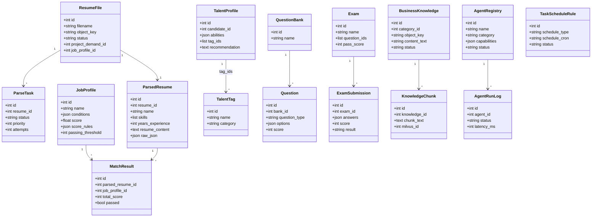
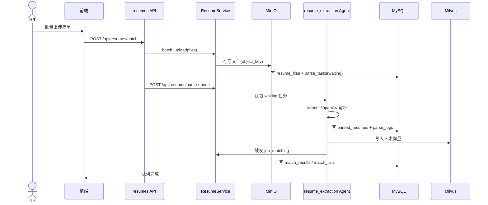
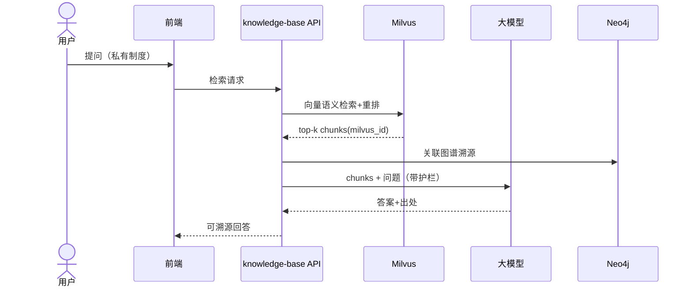
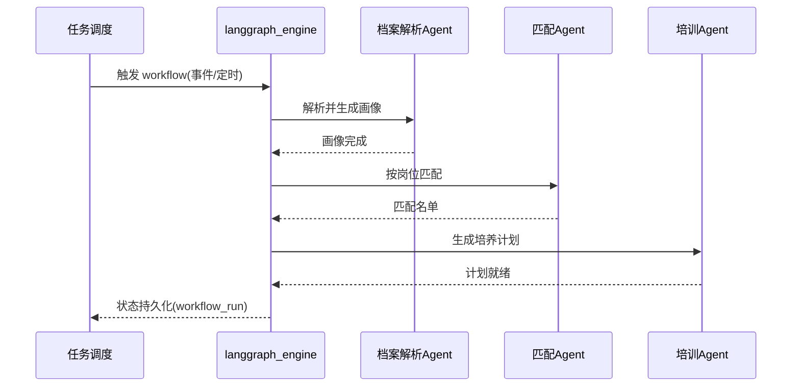
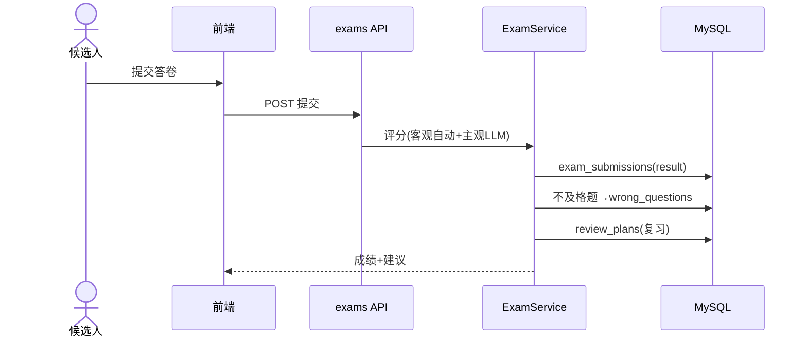
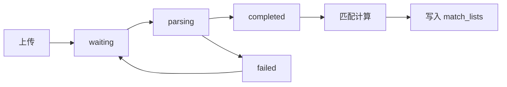
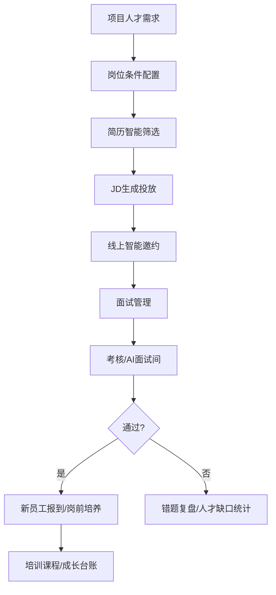
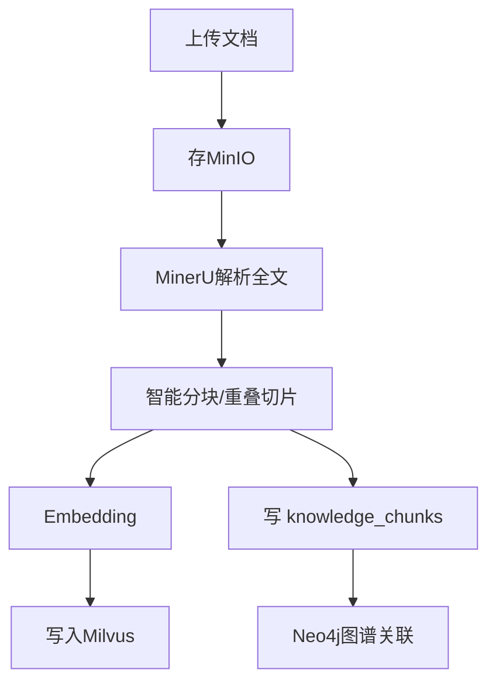
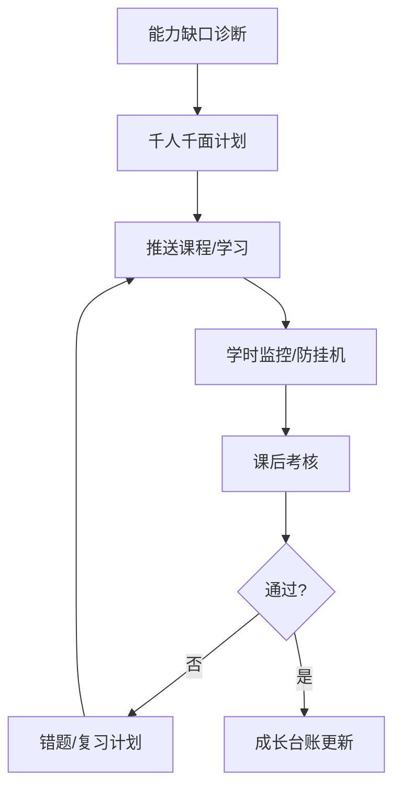
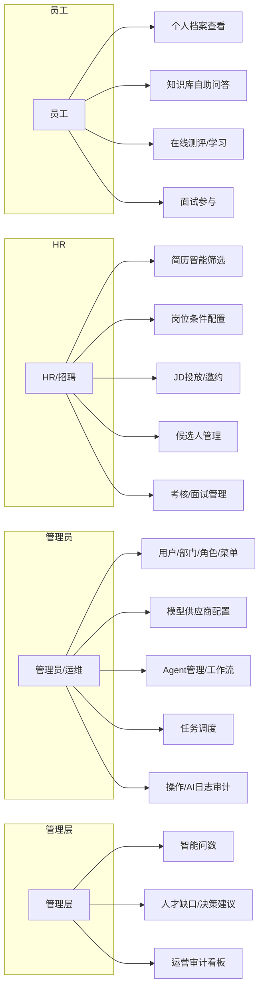

# 详细设计 · 2026 AI 数字化人才平台

> 配套：PRD + 概要设计。本文给出核心模块的详细设计、类图、时序图、流程图与用例图。
> 类/字段以 `backend/app/infrastructure/*` 真实 ORM 模型为准（2026-09-27）。

---

## 1. 设计约束与约定

- 所有 DB 访问经 SQLAlchemy ORM（`dao` + `infrastructure`），无裸 SQL。
- 统一返回：`{code, message, data}`，错误码集中管理（接口设计文档第 3 节）。
- 异步优先：FastAPI `async def`；重任务（简历解析）经 Celery/后台任务。
- 外部 AI/存储依赖经 `tools`/`adapters` 隔离，保留 mock 本地实现以便离线运行。

---

## 2. 核心模块详细设计

### 2.1 简历解析与人才档案
- 入口：`POST /api/resumes/batch`、`POST /api/resumes/parse-queue`。
- 流程：上传（MinIO）→ 建 `resume_files`+`parse_tasks(waiting)` → 调度器按并发认领 → `resume_extraction` agent 调 MinerU/OpenCV 解析 → 写 `parsed_resumes`+`parse_logs` → 触发匹配。
- 产出：`ParsedResume`（姓名/技能/年限/ strengths/raw_json），同时入 Milvus 向量、 talent_profiles 画像。

### 2.2 岗位-人才匹配
- 入口：`job_profiles`（岗位条件）、`match_results`/`match_lists`。
- `job_matching` agent：岗位向量化→与人才向量 Milvus 相似度→硬性过滤+软性加权→0–100 分→写 `match_results` 与 `match_lists`（满足/不满足两类名单）。

### 2.3 AI 测评
- 题库 `question_banks`/`questions` → `exams`（智能出卷，选题库/题目）→ `exam_submissions`（作答评分）→ `exam_interview_results`（面试结论）→ 不及格题入 `wrong_questions` → `review_plans`（复习计划）。

### 2.4 智能培训
- `prejob_plans`（岗前培养，分阶段 phases+课程）+ `training_courses`/`course_attachments`；成长闭环：诊断→计划→学习→考核→复盘。

### 2.5 RAG 知识库
- `business_knowledge`（MinIO 文档）→ 切片 `knowledge_chunks` → Embedding 入 Milvus（milvus_id 关联）→ 检索重排→ 大模型生成（可溯源 `knowledge_id`）。Neo4j 存知识图谱关系。

### 2.6 多智能体编排
- `agent_registry`（智能体注册/状态/指标）+ `agent_run_logs` + `task_schedule_rules`（定时/事件/手动触发）+ `langgraph_engine`（有状态工作流、分支/循环/记忆/人工节点）。

### 2.7 自然语言数据决策
- `data-decision`：用户自然语言→（NL2SQL 引擎，选型待定）→ 查 MySQL/PgSQL → 自动出图/出报告；权限随角色 `data_scope` 行级联动。

### 2.8 权限与安全
- RBAC：`sys_users`↔`sys_user_roles`↔`sys_roles`；`sys_role_permissions`（menu_id+action+data_scope）；`sys_menus` 菜单树；`sys_operation_logs` 全量审计。

---

## 3. 类图（核心域）

---

## 4. 时序图

### 4.1 简历解析 + 匹配流程

### 4.2 RAG 问答流程

### 4.3 智能体工作流执行（LangGraph）

### 4.4 测评提交评分

---

## 5. 流程图

### 5.1 简历解析队列状态机

### 5.2 人才选拔端到端

### 5.3 知识库入库

### 5.4 培训成长闭环

---

## 6. 用例图（按角色）

> Mermaid 无原生用例图，以下用「角色 → 用例」关系图表达（actor 用矩形，用例用圆角矩形）。

---

## 7. 关键算法与设计说明

- **向量检索**：人才/岗位/简历文本经 Embedding 入 Milvus；支持语义/关键词/混合检索 + 重排，目标召回≥95%、检索≤500ms。
- **匹配打分**：岗位向量 vs 人才向量高维相似度（0–100）+ 硬性条件过滤 + 软性加权；结论可解释（`match_lists.reason`）。
- **RAG**：私有知识库切片向量化，检索重排后送大模型，回答绑定 `knowledge_id` 溯源，防幻觉。
- **NL2SQL**：`data-decision` 承接自然语言→SQL；引擎选型（Vanna.ai or 自研）待决策，权限随 `data_scope` 行级联动。
- **多智能体**：LangGraph 状态机支持分支/循环/记忆/人工介入/失败重试；经 `task_schedule_rules` 多样触发。

---

## 8. 交叉引用

- 接口契约 → `docs/design/接口设计.md`
- 数据表结构 → `docs/design/数据库表设计.md`
- 需求与差距 → `docs/PRD-2026-AI数字化人才平台.md`
