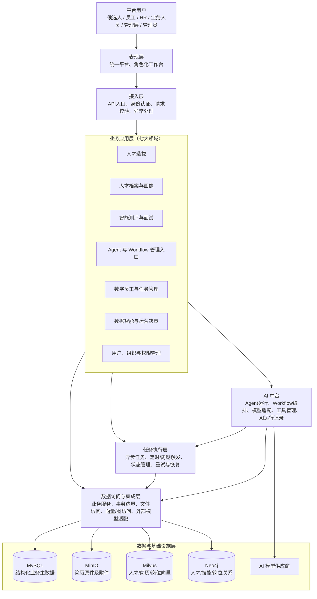
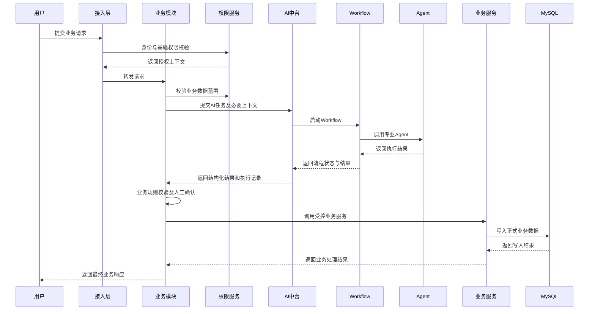
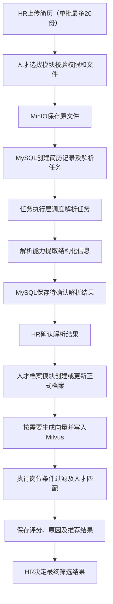
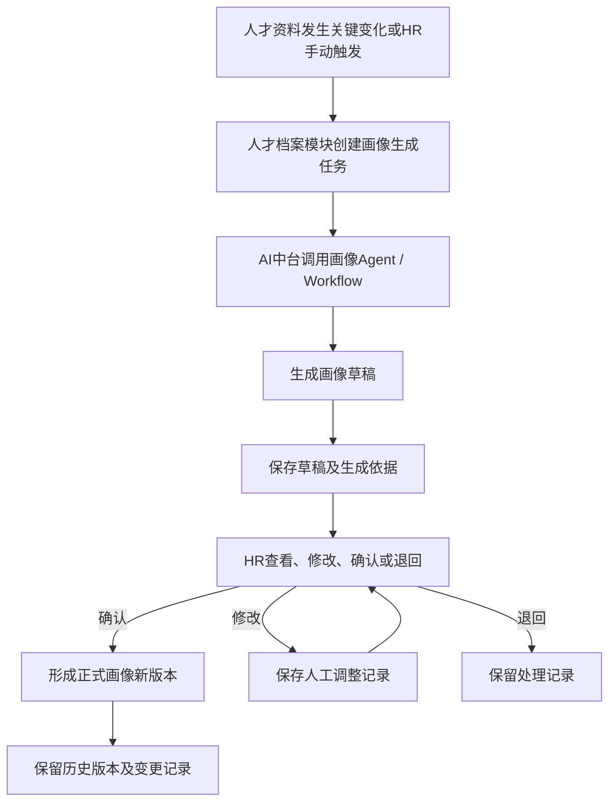
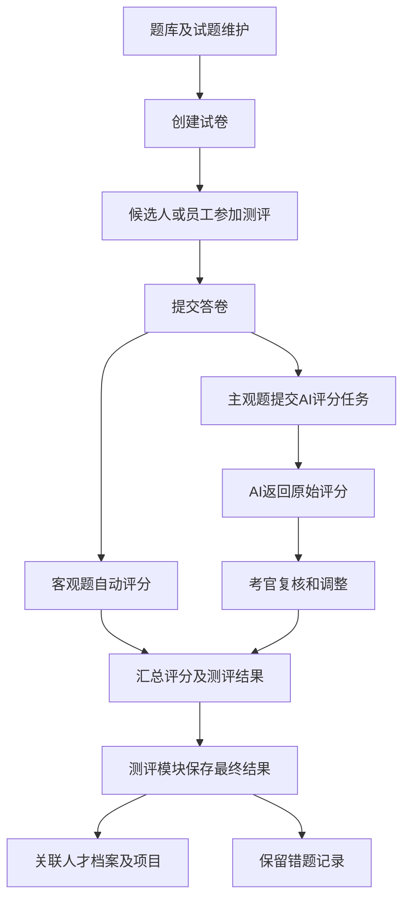
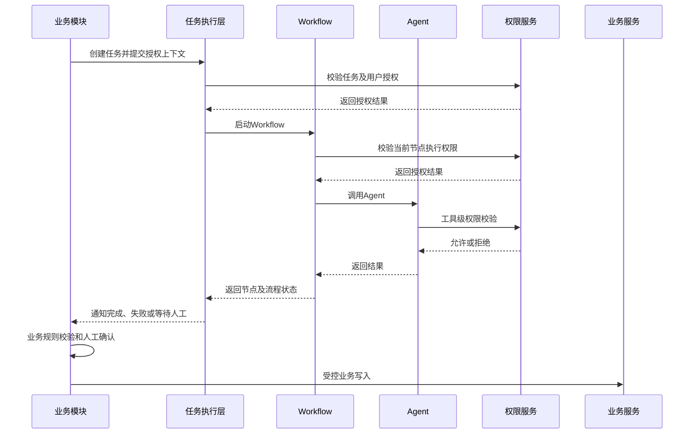
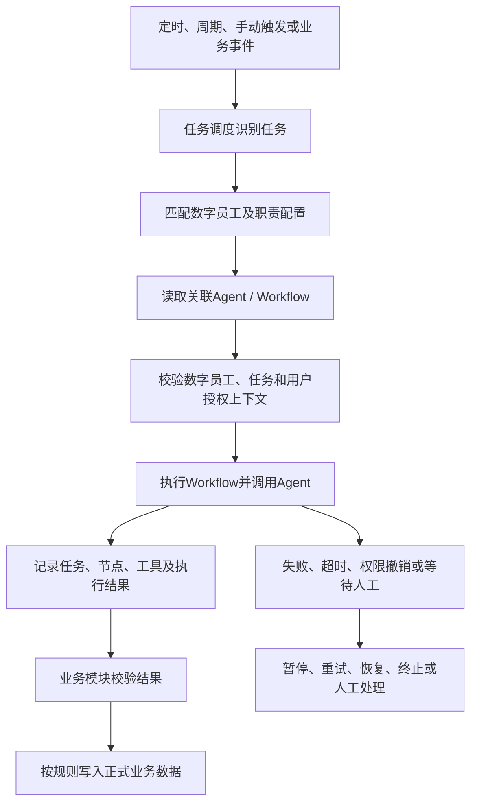
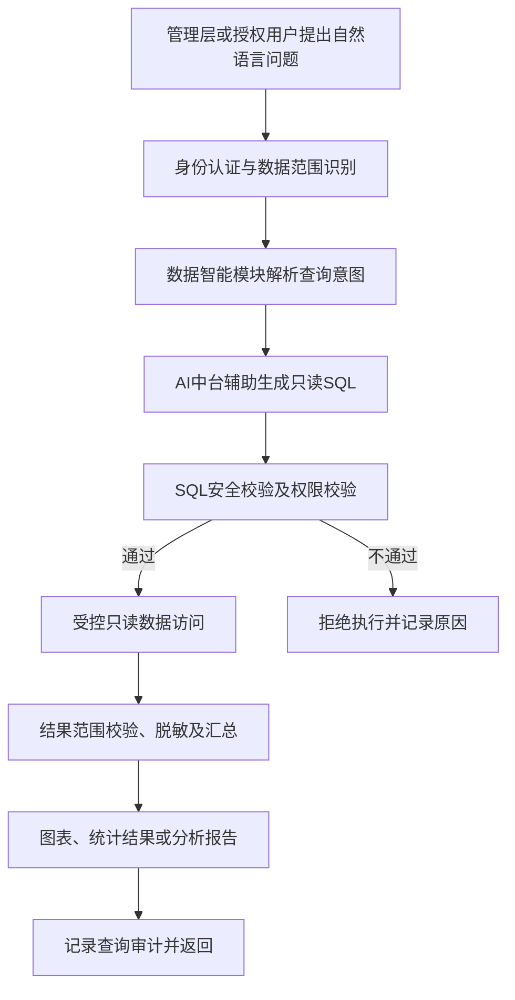
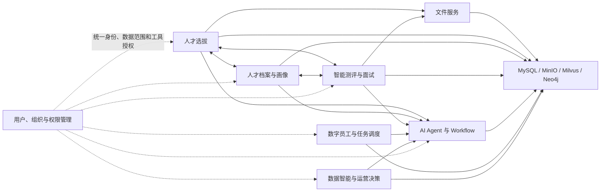
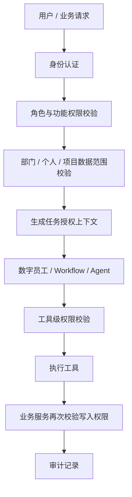

# 02_总体技术架构可行性评估

- **项目名称：** 2026 AI 数字化人才平台
- **所属阶段：** 第二阶段——技术可行性评估
- **步骤编号：** 02-01
- **文档类型：** 总体技术架构可行性评估报告
- **版本：** V1.1（根据业务需求基线修订）
- **评估状态：** 初步评估完成，待用户确认
- **评估依据：** 本次提供的 9 份需求分析文件及《第二阶段·第 1 步：总体技术架构可行性评估》任务说明

---

## 一、评估结论摘要

### 1.1 总体结论

**总体结论：有条件可行。**

根据当前已确认的七大业务领域、业务对象、业务流程、权限规则、数据设计和验收标准，平台采用以下总体架构方向能够支撑本期建设目标：

**前后端分离 + 模块化业务应用层 + 统一 AI 中台 + 独立任务执行能力 + 分层数据存储 + 统一权限与审计体系。**

初期建议采用**模块化单体**作为业务应用的主要实现形态，在代码结构和模块职责上保持领域边界；对简历解析、批量匹配、AI 评分、报告生成等耗时任务采用异步执行。暂不建议将七大业务领域全部拆分为独立微服务。

本次评估确认了总体架构方向，但不等于已经完成基础技术组件、数据库物理模型、API、部署拓扑、性能压测或安全测试。上述内容应在后续专项步骤中继续评估。

### 1.2 关键评估结果

| 评估对象 | 结论 | 主要依据与判断 |
|---|---|---|
| 七大业务领域 | 可行 | 当前范围和功能边界已明确，可按领域划分业务模块 |
| 前后端分离与角色化工作台 | 可行 | 统一平台、统一账号体系，不需要按角色建设多个独立门户 |
| 业务应用层与 AI 中台 | 有条件可行 | 必须坚持业务规则和正式业务状态由业务模块维护 |
| Agent、Workflow、数字员工 | 有条件可行 | 三者概念已有明确区分，仍需落实运行、授权和任务生命周期 |
| 任务执行与调度 | 有条件可行 | 任务状态、重试、恢复、幂等、权限撤销处理均有需求依据 |
| 数据存储架构 | 有条件可行 | MySQL、Milvus、Neo4j、MinIO 已有明确职责，但跨存储一致性需设计 |
| 权限与安全 | 有条件可行 | RBAC、部门/个人/项目数据范围、工具权限继承已有需求基线 |
| 数据智能与 NL2SQL | 有条件可行 | 只读查询、权限校验和 SQL 安全校验为必要前提 |
| 初期规模与性能 | 有条件可行 | 用户及任务规模已有基线，性能目标仍需制定测试口径 |
| 部署与扩展方式 | 有条件可行 | 初期模块化单体更适合当前规模，按实际瓶颈再拆分 |

### 1.3 本次评估形成的主要架构原则

1. 业务应用层负责业务规则、业务状态、正式业务数据和人工确认流程。
2. AI 中台负责 Agent、Workflow、模型供应商、工具及 AI 运行记录的统一管理与执行。
3. 数字员工是承担数字化业务职责的虚拟执行主体；Agent 提供专业任务能力；Workflow 组织执行过程。
4. 任务调度负责定时、周期和手动触发，并管理任务实例的生命周期。
5. AI 结果默认属于建议、草稿或待确认结果；只有满足业务规则和人工确认要求后，才进入正式业务数据。
6. MySQL 是结构化业务主数据来源；Milvus 存储向量；Neo4j 存储图关系；MinIO 存储原始文件和附件。
7. 本期不使用 Redis，不将 Redis 作为缓存、会话或任务队列的前置依赖。
8. 长耗时任务异步执行；Agent 单次任务最长执行时间为 2 分钟。
9. 权限控制贯穿用户请求、业务服务、任务授权上下文、Agent、Workflow、工具执行和结果回写。
10. 初期采用模块化单体，避免在业务规模和部署需求尚不明确时过早引入全面微服务。

---

## 二、评估依据与需求基线

### 2.1 本次使用的业务资料

本次评估使用用户提供的以下 9 份文件：

1. `00_总需求文档.md`
2. `01_部分功能需求文档.md`
3. `02_项目定位与用户场景(2).md`
4. `02_业务对象功能与流程.md`
5. `03_功能范围说明(1).md`
6. `03_权限设计说明.md`
7. `03_数据设计说明.md`
8. `03_验收标准.md`
9. `03_业务规则与状态流转.md`

另以《第二阶段·第 1 步：总体技术架构可行性评估》作为本报告的评估任务范围和交付要求。

### 2.2 资料版本及冲突处理

本次资料中存在不同阶段的需求表述：

- `00_总需求文档.md` 为 V0.1 初稿，仍包含岗前培养与培训课程、企业知识库等早期范围。
- `01_部分功能需求文档.md` 为七大业务范围 V0.2，已明确收缩当前建设范围。
- 项目定位与用户场景、业务对象功能与流程等 V1.0 文件已记录 36 项补充确认结果。
- 权限、数据、功能范围和验收文件提供了对应主题的需求基线。
- `03_业务规则与状态流转.md` 集中记录跨模块状态、异常处理和人工介入规则。

因此，本报告以**七大业务范围 V0.2 及后续已确认的 V1.0 业务基线**为当前评估依据。V0.1 中与当前范围冲突的培训课程、企业知识库、Redis 等早期设计内容，不直接作为本期架构要求。

若不同专题文件之间存在表述差异，应按各自负责主题处理，并在详细设计前完成一致性检查；不能将尚未确认的细节自行补充为既定需求。

### 2.3 当前七大业务领域

1. 人才选拔管理。
2. 人才档案与人才画像。
3. 智能测评与面试管理。
4. AI Agent 与工作流管理。
5. 数字员工与任务调度。
6. 数据智能与运营决策。
7. 用户、组织与权限管理。

明确不纳入当前版本：

- 岗前培养与培训课程。
- 企业知识库。
- 错题复习计划。

### 2.4 已确认的关键业务关系

- 项目可以独立存在，也可以归属于项目群；项目群包含多个项目；项目包含一个或多个项目需求；一个项目需求可以关联多个岗位。
- 一个自然人对应一份人才主档案；候选人和员工是不同阶段的业务身份；一个账号同一时点只能对应一种业务身份。
- 候选人录用后，原账号业务身份转换为员工身份，保留账号标识、人才主档案及候选人阶段历史记录。
- 一个用户可以拥有多个系统角色；业务身份与系统角色分开管理。
- 人才画像由 AI 生成草稿，HR 确认后成为正式画像；历史版本及变更记录需要保留。
- 简历解析结果先进入待确认状态，HR 确认后才写入正式人才档案。
- 人才匹配结果用于辅助筛选，最终筛选由 HR 决定。
- 主观题由 AI 提供评分，考官可以复核和调整。
- Agent 执行工具时继承所属数字员工或任务的授权上下文，并受工具级权限约束。
- 一个数字员工可以关联多个 Agent 和 Workflow；数字员工负责业务职责和任务组织，Agent 提供专业任务能力，Workflow 组织执行过程。
- Workflow 采用固定主流程与动态分支相结合的方式，并支持失败节点恢复或授权人员重新执行。
- NL2SQL 仅允许只读查询，必须通过权限校验和 SQL 安全检查。
- 部门之间默认数据隔离；特殊项目通过平台管理员审批的项目授权开展跨部门协作。

### 2.5 初期规模与约束

| 指标 | 当前确认基线 |
|---|---:|
| 初期注册用户 | 100 人以内 |
| 初期同时在线用户 | 20 人以内 |
| 单次批量简历上传 | 最多 20 份 |
| Agent 单次任务最长执行时间 | 2 分钟 |
| 数据备份 | 每天一次，并定期验证恢复 |
| 系统可用性 | 本期不设固定百分比，需具备监控、异常告警及恢复机制 |

页面响应、普通接口响应、向量检索耗时、召回率、报表生成时间等原设计指标仍需确定测试环境、数据规模、并发模型及统计口径，暂不作为已批准的硬性验收门槛。

---

## 三、总体逻辑架构评估

### 3.1 建议的总体逻辑架构

以上为逻辑架构，不表示每一层或每个模块必须独立部署。

### 3.2 分层职责与可行性

| 层次 | 主要职责 | 可行性判断 | 架构约束 |
|---|---|---|---|
| 表现层 | 统一平台、角色化工作台，向不同角色展示授权菜单和业务入口 | 可行 | 不按每个角色建设完全独立的平台；前端隐藏菜单不能代替后端鉴权 |
| 接入层 | API 入口、身份认证、请求校验、统一异常处理 | 可行 | 认证后仍需在业务服务执行数据范围权限校验 |
| 业务应用层 | 七大领域的业务规则、业务状态、业务服务及正式数据维护 | 可行 | 每个领域明确数据责任；模块间通过服务边界协作 |
| AI 中台层 | Agent、Workflow、模型供应商、工具及 AI 运行管理 | 有条件可行 | 不越权决定业务状态，不直接绕过业务服务写核心业务数据 |
| 任务执行层 | 定时、周期、手动触发，异步执行，任务状态、重试、恢复和异常管理 | 有条件可行 | 任务状态持久化；具备幂等、超时、权限复核和失败恢复 |
| 数据访问与集成层 | 封装 MySQL、MinIO、Milvus、Neo4j 和模型服务访问 | 可行 | 明确各存储的主从关系、同步边界和失败补偿 |
| 数据与基础设施层 | 结构化数据库、对象存储、向量库、图数据库及模型服务 | 有条件可行 | 具体部署、版本、容量、备份及资源需求在专项评估中确认 |

### 3.3 部署形态建议

初期建议采用：

**前端独立应用 + 模块化单体后端 + 独立异步任务执行进程 + 按职责部署的数据服务。**

具体建议：

- 前端统一登录入口，根据用户角色、功能权限和数据范围展示工作台。
- 后端可以先以一个业务应用部署，但内部按七大领域组织代码和服务。
- AI 中台先作为逻辑独立模块，统一接收 AI 任务并执行 Agent/Workflow。
- 任务执行器与在线 API 处理进程逻辑隔离，避免长任务占用在线请求资源。
- MySQL、MinIO、Milvus、Neo4j 按各自职责提供存储能力。
- 模型供应商通过统一适配层接入，业务模块不直接绑定某一家模型供应商。

当前用户规模为注册用户 100 人以内、同时在线 20 人以内，尚无必须采用全面微服务的规模依据。模块化单体更有利于降低部署、运维、跨服务事务和排障复杂度。

后续若出现独立扩缩容、独立发布、资源隔离或团队协作需求，再按边界拆分服务。

---

## 四、业务应用层与 AI 中台职责边界

### 4.1 职责划分

| 能力 | 业务应用层 | AI 中台 |
|---|---|---|
| 人才、项目、岗位、测评等业务规则 | 负责 | 不负责最终裁定 |
| 核心业务数据及业务状态 | 负责维护 | 不作为权威数据来源 |
| 简历解析、匹配、画像、主观题评分等 AI 任务 | 提交任务、提供必要上下文、处理结果 | 组织 Agent/Workflow 执行 |
| Agent 注册、能力、状态及版本 | 提供业务使用场景 | 负责统一管理 |
| Workflow 定义、动态分支和执行记录 | 提供业务触发及结果接收规则 | 负责流程编排与执行 |
| 模型供应商和模型配置 | 不直接绑定具体供应商 | 统一适配和管理 |
| 工具定义与调用 | 提供受控业务服务能力 | 管理工具接入、调用及执行记录 |
| AI 结果确认与正式写回 | 负责业务校验、人工确认及正式保存 | 返回结构化结果和执行信息 |
| 审计 | 记录业务操作和结果 | 记录模型、Agent、Workflow 和工具调用 |

### 4.2 推荐执行链路

### 4.3 AI 结果的业务控制边界

| AI 场景 | AI 输出 | 正式业务生效条件 |
|---|---|---|
| 简历解析 | 结构化解析结果 | HR 确认后写入正式人才档案 |
| 人才岗位匹配 | 硬性条件过滤、综合评分、匹配原因和推荐名单 | HR 决定最终筛选结果 |
| JD 生成 | JD 草稿 | HR 确认后发布 |
| 人才画像 | 画像草稿、标签、优势及待提升项 | HR 确认后形成正式画像 |
| 主观题评分 | AI 原始评分和依据 | 考官复核、调整后记录最终评分 |
| NL2SQL | 只读查询 SQL 或查询方案 | 权限校验和 SQL 安全校验通过后执行 |

### 4.4 架构约束

1. Agent 不得直接连接 MySQL 并绕过业务服务修改核心业务表。
2. AI 模型输出不得直接改变业务状态。
3. 业务模块向 AI 中台传递最小必要上下文。
4. AI 结果必须进行格式校验、业务规则校验和权限校验。
5. 人工确认前的结果必须与正式业务数据区分。
6. 模型切换应主要发生在 AI 中台适配层，避免业务模块随供应商变化而修改。
7. AI 运行记录必须能够关联业务对象、任务、Agent/Workflow 版本及工具调用。

**评估结论：有条件可行。** 关键条件是业务应用层保留业务主导权，AI 中台只提供受控的智能执行能力。

---

## 五、七大业务领域模块边界评估

### 5.1 模块职责表

| 业务领域 | 核心职责 | 主要输入 | 主要输出 | 主要依赖 |
|---|---|---|---|---|
| 人才选拔管理 | 项目群、项目、项目需求、岗位条件、简历、候选人、匹配、JD、邀请及面试管理 | 项目需求、岗位配置、简历文件、候选人信息 | 解析任务、候选人记录、匹配结果、招聘状态、邀约和面试记录 | 人才档案、文件服务、AI 中台、权限服务 |
| 人才档案与人才画像 | 统一人才主档案、候选人/员工身份、人才基础信息、画像草稿、正式画像和历史版本 | 简历确认结果、招聘、测评、面试等业务资料 | 人才主档案、身份记录、画像草稿和正式版本 | 人才选拔、测评面试、AI 中台 |
| 智能测评与面试 | 题库、试题、试卷、答卷、评分、复核、测评结果、错题及面试记录 | 测评配置、候选人/员工、答卷、面试信息 | 评分记录、复核结果、测评结果、面试结论、错题记录 | 人才档案、AI 中台、权限服务 |
| AI Agent 与工作流管理 | Agent 注册、能力、状态、版本、发布、Workflow 定义、动态分支、执行及工具记录 | 业务任务、执行上下文、模型和工具配置 | AI 结果、Workflow 状态、Agent/工具调用记录 | 模型服务、任务执行层、工具服务、权限服务 |
| 数字员工与任务调度 | 数字员工注册、职责、职责流程、Agent/Workflow 关联、定时/周期/手动任务 | 数字员工配置、任务触发规则、业务事件 | 任务实例、执行状态、结果、异常记录 | AI 中台、任务执行层、业务模块、权限服务 |
| 数据智能与运营决策 | NL2SQL、授权数据查询、统计分析、图表、报告及运营分析 | 用户问题、授权范围、业务数据 | 只读查询结果、统计指标、图表及报告 | 权限服务、受控数据访问层、AI 中台 |
| 用户、组织与权限管理 | 用户、部门、角色、菜单、操作权限、数据范围、项目授权、邀请、审批及审计 | 用户身份、组织关系、角色和授权配置 | 身份认证、授权上下文、权限判定、审计记录 | 全部业务模块及 AI 中台 |

### 5.2 公共能力建议

以下能力适合形成跨模块公共服务：

- 统一身份认证与权限校验。
- 人才主档案标识及身份关联访问。
- 文件上传、下载、元数据管理和访问控制。
- 统一任务创建、查询、取消、状态更新和通知。
- AI 任务提交、结果接收和运行记录关联。
- 统一业务日志、系统运行日志、AI 调用日志和审计日志。
- 统一异常处理和操作留痕。
- 数据导出及报告文件生成能力。

公共能力需要明确数据归属和调用边界，不能成为职责不清的“大杂烩模块”。

### 5.3 关键模块边界判断

| 边界问题 | 评估结论 | 处理原则 |
|---|---|---|
| 候选人与员工是否维护两份独立人才主档案 | 不应重复维护 | 一份人才主档案关联不同阶段业务身份 |
| 候选人录用后是否创建新账号 | 不应另建替代账号 | 原账号身份转换，保留历史业务记录 |
| 画像由谁最终确认 | 业务模块和 HR 负责 | AI 只生成草稿，HR 确认后生效 |
| 匹配结果由谁决定 | HR 负责最终筛选 | AI 提供评分、原因及名单 |
| Agent 是否维护招聘或测评状态 | 不负责 | 由对应业务服务维护状态 |
| Workflow 是否等同数字员工 | 不等同 | Workflow 是执行流程，数字员工是职责主体 |
| 数字员工管理员是否能扩大授权 | 不可以 | 平台管理员负责创建及整体授权，数字员工管理员负责授权范围内日常管理 |
| 数据智能是否能任意查询业务库 | 不可以 | 通过权限过滤和受控只读访问执行 |

---

## 六、核心业务协作流程与依赖关系

### 6.1 人才选拔：简历上传、解析、归档和匹配

**边界与执行方式：**

- 文件上传及基础校验可同步完成。
- 原始简历写入 MinIO，文件元数据、解析任务和结构化结果写入 MySQL。
- 解析任务异步执行，失败自动重试，达到重试上限后标记失败并允许人工重新发起。
- 解析结果进入待确认状态，HR 确认后才写入正式人才档案。
- 人才、简历及岗位向量存入 Milvus，并保留 MySQL 业务对象标识。
- 匹配结果关联人才、简历版本、岗位和项目需求，HR 决定最终筛选结果。

### 6.2 人才画像生成与确认

- 人才档案模块维护画像状态和正式版本。
- AI 中台负责生成画像草稿。
- HR 确认后正式生效。
- 画像历史版本、来源、生成依据及人工调整记录均应可追溯。
- 新画像不得直接覆盖历史版本。

### 6.3 测评、评分、复核和归档

测评与面试的先后顺序由项目或岗位配置，可以先测评后面试、先面试后测评，也可以只安排其中一项。测评和面试分别记录并关联人才档案及招聘项目。本期不建设错题复习计划。

### 6.4 Agent、Workflow 与任务执行

Agent 单次任务最长执行时间为 2 分钟。失败后按错误类型自动重试、人工介入或终止。Workflow 支持固定主流程与动态分支，支持从失败节点恢复或授权人员重新执行；恢复时必须识别已成功节点，防止重复业务副作用。

### 6.5 数字员工接收任务与执行

数字员工负责业务职责和任务组织；Agent 提供专业任务能力；Workflow 组织执行过程；任务调度负责触发及任务生命周期。数字员工管理员只在平台管理员授予的权限范围内管理日常职责、任务和运行监控。

### 6.6 NL2SQL 与运营分析

NL2SQL 不允许写入、修改或删除数据。禁止将模型生成的 SQL 未经校验直接交给生产数据库执行。只读账号、表/字段范围、超时和结果限制等细节需在数据智能及安全专项评估中确定。

### 6.7 核心模块依赖关系

图中的双向关系表示业务协作和结果关联，不代表模块可以直接访问对方内部数据表。权限管理为所有模块提供授权依据；各业务模块通过受控服务访问其责任数据。

---

## 七、数据分类、存储职责与流转评估

### 7.1 当前数据存储基线

| 存储组件 | 当前定位 | 主要数据 | 架构判断 |
|---|---|---|---|
| MySQL | 结构化业务主数据库 | 用户、组织、角色、项目、岗位、人才档案、候选人/员工身份、测评、面试、Agent、Workflow、数字员工、任务、邀请和审计记录 | 作为业务主数据来源 |
| MinIO | 对象文件存储 | 简历原文件及相关业务附件 | 原文件与业务元数据分离保存 |
| Milvus | 向量数据存储 | 人才、简历及岗位向量 | 用于相似度检索和匹配辅助，不作为人才主数据来源 |
| Neo4j | 图关系存储 | 人才、技能、岗位之间的关系 | 图谱节点应关联 MySQL 业务主键 |

**明确边界：**

- MySQL 作为结构化业务主数据库。
- 当前不引入 PgSQL。
- 当前暂不使用 Redis，不将 Redis 作为本期缓存、会话或任务队列的前置依赖。
- 不得因为早期 V0.1 文件中出现 Redis，就将其视为当前已确认组件。
- 以上存储组件的最终部署形态、版本、容量和高可用方案仍需后续技术评估。

### 7.2 数据分类与责任归属

| 数据类别 | 数据示例 | 主要责任方 | 管理原则 |
|---|---|---|---|
| 核心业务数据 | 项目、项目需求、岗位、人才主档案、业务身份、测评和面试记录 | 对应业务模块，MySQL 保存结构化主数据 | 明确唯一业务责任模块 |
| 文件数据 | 简历原件、附件、报告文件 | 文件服务及对应业务模块，MinIO 保存文件 | MySQL 保存文件元数据、对象标识和业务关联 |
| 向量数据 | 人才、简历、岗位向量 | 人才匹配/向量访问能力，Milvus 保存向量 | 记录可回查的业务对象标识 |
| 图关系数据 | 人才、技能、岗位关系 | 人才关系/图谱访问能力，Neo4j 保存关系 | 节点关联 MySQL 业务主键 |
| AI 配置数据 | Agent、Workflow、模型供应商和工具配置 | AI 中台，结构化配置归 MySQL 管理 | 配置版本化和变更留痕 |
| AI 运行数据 | Agent 执行、Workflow 节点、工具调用、任务状态、错误及耗时 | AI 中台和任务执行层 | 与业务对象和任务实例关联 |
| 分析数据 | 统计结果、查询结果、图表及报告 | 数据智能模块 | 保留数据来源、授权范围和统计口径 |
| 审计数据 | 用户操作、权限变更、敏感操作和 AI 调用审计 | 统一审计能力 | 分类管理、访问控制和留存 |

### 7.3 主要数据流转

**简历及人才匹配：**

简历原件 → MinIO；文件元数据、解析任务及结构化解析结果 → MySQL；人才/简历/岗位向量 → Milvus；人才、技能及岗位关系 → Neo4j；匹配结果及业务状态 → MySQL。

**人才画像：**

MySQL 中的人才及业务资料 → AI 中台生成画像草稿 → 业务模块保存待确认草稿 → HR 确认 → MySQL 保存正式画像新版本及变更记录。

**测评与面试：**

题库、试题、试卷、答卷、AI 原始评分、人工复核结果、最终成绩、错题及面试记录由测评与面试业务模块维护，结构化结果存入 MySQL。

**Agent 与数字员工：**

Agent/Workflow 配置、版本、任务触发、节点状态、工具调用和执行结果需要能够关联；结构化配置与运行元数据由 MySQL 管理，任务执行由任务执行层负责。

**NL2SQL：**

用户问题 → 权限范围判定 → SQL 生成 → SQL 安全检查 → 受控只读数据访问 → 结果整理与审计。

### 7.4 跨存储一致性和数据生命周期

业务资料已明确以下要求：

- MySQL 是业务主数据来源。
- Milvus 和 Neo4j 数据保留 MySQL 业务对象标识。
- 文件、向量和图关系数据可定位对应业务对象。
- 更新、删除或状态变化时，应定义关联存储同步规则。
- 同步失败需要能够识别、记录并支持后续处理。
- 人才档案删除先逻辑删除，关联数据进入待清理状态；校验后统一处理 MySQL、MinIO、Milvus、Neo4j 中的关联数据。
- 候选人个人信息删除请求经管理员审核，按数据类别删除或匿名化，并处理各存储关联数据。
- 简历原文件及解析结果保留历史版本和来源记录。
- 人才画像保留全部历史版本。
- 业务日志、系统运行日志、AI 调用日志、审计日志分类管理，分别配置访问权限和保留期限。
- 数据每天备份一次，并定期验证恢复能力。

**架构建议：** 不把跨存储更新假设为一个数据库事务。应设计可追踪的同步任务、失败记录、重试或补偿流程，并保留人工处理入口。具体一致性策略、补偿机制和删除编排放在数据专项详细设计中确定。

### 7.5 Redis 不使用对任务架构的影响

当前不使用 Redis 是明确约束，但这并不代表可以省略异步任务能力。

任务执行层仍需提供：
- 任务持久化及状态查询。
- 任务领取和并发控制。
- 失败重试、超时、取消和恢复。
- 幂等及重复执行保护。
- 定时、周期和手动触发。
- 任务与业务对象、用户、Agent、Workflow 的关联。

在不使用 Redis 的前提下，任务队列/调度实现方式需在基础技术组件评估中确定。可评估基于 MySQL 持久化任务表与独立 Worker 的方案，或其他不违反当前约束的实现；本报告不将该候选方案视为已确认选型，也不在此确定 Celery 或其他队列技术。

---

## 八、同步、异步与任务调度边界

### 8.1 执行方式划分

| 任务类型 | 业务场景 | 建议执行方式 | 原因 |
|---|---|---|---|
| 普通查询 | 个人档案、项目、任务状态、配置读取 | 同步 | 需要即时返回 |
| 文件接收 | 简历上传及基础校验 | 同步接收，处理异步化 | 上传结果可即时确认，解析过程耗时 |
| 简历解析 | 单批最多 20 份简历 | 异步 | 解析时间和资源消耗不稳定 |
| 人才匹配 | 多人才、多岗位条件匹配 | 根据规模可同步或异步；批量场景建议异步 | 需要模型/向量检索及评分 |
| AI 评分 | 主观题评分 | 异步或受控执行 | 需要保留原始评分和人工复核 |
| 画像生成 | 自动或人工触发的画像生成 | 异步 | 需要汇总多类人才资料并调用模型 |
| 报告生成 | 统计分析报告 | 异步优先 | 任务耗时和数据量不确定 |
| 任务调度 | 定时、周期、手动触发 | 调度触发 + 异步执行 | 需持续维护任务状态 |
| 人工确认 | 画像确认、解析确认、评分复核、敏感操作审批 | 人工待办/等待人工 | 需要责任人执行确认 |

### 8.2 任务状态和执行要求

业务规则已定义的任务状态包括：

- 待执行
- 执行中
- 等待人工
- 重试中
- 已成功
- 已失败
- 已暂停
- 已取消
- 已终止

任务执行层至少需要支持：

1. 创建、查询、状态更新和取消任务。
2. 任务状态持久化，服务重启后能够识别未完成任务。
3. 幂等控制，防止重复投递或重试产生重复业务副作用。
4. 超时控制；Agent 单次任务最长执行时间为 2 分钟。
5. 根据错误类型决定自动重试、人工介入或终止。
6. 重试次数、间隔和错误分类可配置，具体数值待详细设计。
7. Workflow 从失败节点恢复时识别已成功节点，避免重复执行。
8. 权限发生变化时重新校验，阻断后续未授权工具调用和业务操作。
9. 失败、暂停、恢复、取消、终止和人工处理均记录审计信息。
10. 控制任务并发及模型、解析和存储资源使用，避免任务集中执行造成资源争抢。

### 8.3 异步执行方案判断

由于本期明确不使用 Redis，不能沿用“Redis 作为任务队列前置依赖”的架构假设。

建议在下一步基础技术组件评估中重点比较：
- MySQL 持久化任务表 + 独立 Worker 的实现可行性；
- 定时/周期调度与普通异步任务执行的职责划分；
- 任务领取、锁定、超时恢复和并发控制方式；
- 是否需要引入其他消息中间件，以及引入后的运维成本。

当前只确定异步执行的架构需求，不确定具体队列、调度器或 Worker 框架。

---

## 九、权限与安全架构评估

### 9.1 当前权限模型

采用 **RBAC 作为基础 + 数据范围控制** 的组合模型。

权限判断至少包括：
1. 用户身份是否有效。
2. 用户拥有的系统角色。
3. 角色是否具备目标功能权限。
4. 用户是否具备目标数据范围权限。
5. 业务对象是否属于用户所在部门或已授权项目。
6. Agent、数字员工或任务是否具有相应工具执行权限。

功能操作权限包括 view、create、edit、delete、export。数据范围包括：
- all：全部数据，仅对明确获批的管理角色开放。
- dept：部门数据。
- self：个人数据。
- project：项目授权数据。

### 9.2 权限控制位置

| 控制项 | 架构位置 | 要求 |
|---|---|---|
| 身份认证 | 接入层/统一身份服务 | 候选人账号通过邀请产生，不开放自主注册 |
| 角色与功能权限 | 用户、组织与权限模块 | 前后端均执行权限检查 |
| 部门、个人和项目数据范围 | 业务应用层及数据访问层 | 默认部门隔离，跨部门按项目授权 |
| 候选人个人信息 | 业务应用层及数据访问层 | 仅访问本人授权数据 |
| 数据导出 | 业务服务 | export 独立授权，不因 view 自动获得 |
| Agent 调用 | AI 中台和业务应用层 | 传递任务身份、用户身份和授权上下文 |
| 工具执行 | 工具适配层 | 同时校验上层授权和工具细粒度权限 |
| NL2SQL | 数据智能模块及受控数据访问层 | 只读、权限过滤、SQL 安全校验 |
| AI 结果写回 | 业务应用层 | 通过受控业务服务及人工确认流程 |
| 审计 | 统一审计能力 | 覆盖用户、业务、任务、AI 和工具操作 |

### 9.3 Agent / Workflow / 数字员工授权链路

权限撤销或变化后，运行中的 Agent/Workflow 必须重新校验授权。权限撤销后禁止后续未授权工具调用或业务操作；按任务风险和执行阶段暂停或终止，并记录处理过程。

### 9.4 敏感操作与审批

至少包括：
- 人才档案及候选人关键信息批量导出。
- 批量删除或不可逆数据变更。
- 角色、权限及数据范围调整。
- 跨部门项目授权。
- 模型供应商、模型密钥及关键配置变更。
- Agent/数字员工高风险工具授权。
- 可能影响候选人招聘状态或测评结论的关键操作。

审批人、审批层级和审批条件按业务类型及风险配置；具体阈值和时限待详细设计。

**评估结论：有条件可行。** 必须把权限上下文作为任务执行的组成部分，而不是只在登录或 API 入口做一次检查。

---

## 十、性能、规模与扩展性评估

### 10.1 当前规模是否支持模块化单体

初期注册用户 100 人以内、同时在线 20 人以内，单次最多上传 20 份简历，Agent 单次任务最长 2 分钟。该规模不足以单独证明需要全面微服务架构。

建议：
- 业务模块先在一个后端应用内按领域隔离。
- 文件解析和 AI 任务由独立 Worker 执行。
- 模型推理、向量检索、图查询与在线 API 资源适当隔离。
- 对批量任务设置并发限制。
- 后续通过监控和压测结果判断是否拆分。

### 10.2 资源和性能风险

| 风险点 | 可能影响 | 建议措施 |
|---|---|---|
| 简历解析与模型推理争用资源 | 在线接口变慢、任务排队 | 异步执行、并发限制、任务超时 |
| 同时执行多个 Agent | 模型服务拥塞、任务超过 2 分钟 | 限制并发，记录耗时，按错误类型处理 |
| 向量与图查询增加 | 匹配和分析延迟上升 | 建立索引和监控，按数据规模评估 |
| NL2SQL 复杂查询 | 数据库负载或长时间占用连接 | 只读访问、查询超时、结果限制和查询审计 |
| 跨存储同步失败 | MySQL 与向量/图/文件关联不一致 | 同步任务、失败记录、重试/补偿和对账 |
| 任务执行器故障 | 异步任务积压或中断 | 任务持久化、重启恢复和异常告警 |

### 10.3 性能验收边界

当前确认的规模约束可作为本期容量基线。原设计中页面响应 ≤1 秒、普通接口 ≤1 秒、向量检索 ≤500 毫秒、报表生成 3–5 秒、向量召回率 ≥95% 等指标，必须先明确数据量、测试集、并发量、硬件环境和统计方法，才能作为正式验收指标。

原设计热点缓存命中率 ≥98% 依赖缓存层，但当前明确暂不使用 Redis，因此不能直接将其作为本期 Redis 验收指标。

---

## 十一、总体架构风险清单

风险等级为本次初步判断，后续需结合组件评估、详细设计和测试结果更新。

| 编号 | 涉及模块 | 风险描述及原因 | 可能影响 | 等级 | 建议处理方式 | 状态 |
|---|---|---|---|---|---|---|
| R-01 | 业务层 / AI 中台 | 业务规则散落在 Agent Prompt 或模型输出中 | 业务规则不一致，模型变化影响业务 | 高 | 业务规则由业务模块维护 | 待设计约束 |
| R-02 | AI 中台 / 业务数据 | Agent 绕过业务服务直接写核心数据 | 错误数据、越权和审计缺失 | 高 | 受控业务服务写入，人工确认按规则执行 | 待设计约束 |
| R-03 | 人才档案 | 候选人和员工重复建立主档案 | 身份关系混乱、数据重复 | 高 | 统一人才主档案，业务身份分阶段关联 | 已有规则，待实现 |
| R-04 | 数字员工 / Agent / Workflow | 三者职责混淆 | 配置重复、调度和授权混乱 | 高 | 明确职责主体、专业能力、流程编排和任务触发边界 | 待专项设计 |
| R-05 | 任务执行层 | 不使用 Redis 后，异步任务实现方式尚未确定 | 任务积压、丢失或并发控制不足 | 高 | 下一步比较持久化任务表、Worker 和其他候选方案 | 待组件评估 |
| R-06 | 任务执行层 | 缺少幂等、重试和失败恢复 | 重复写入、重复发送或任务丢失 | 高 | 幂等键、有限重试、失败恢复和补偿机制 | 待详细设计 |
| R-07 | 权限 / AI 工具 | Agent 权限与用户/任务授权脱节 | 越权访问和敏感操作 | 高 | 授权上下文继承、工具级校验、权限撤销复核 | 待专项设计 |
| R-08 | 数据智能 | NL2SQL 执行不受控 | 数据泄露、误查询或数据库负载异常 | 高 | 只读账号、权限过滤、SQL 校验、超时和结果限制 | 待专项评估 |
| R-09 | 跨存储数据 | MySQL、MinIO、Milvus、Neo4j 数据不同步 | 数据错配、删除不完整 | 高 | 统一关联标识、同步任务、失败补偿和对账 | 待详细设计 |
| R-10 | 文件服务 | 文件原件、版本、解析结果与人才对象关联不完整 | 追溯困难、数据错配 | 中 | 文件元数据、版本和业务对象关联 | 待详细设计 |
| R-11 | AI 中台 | 业务模块直接绑定模型供应商 | 模型切换成本高 | 中 | 统一模型适配层 | 待组件评估 |
| R-12 | 数据治理 | 日志、个人信息及关联数据缺少生命周期策略 | 合规、存储和审计风险 | 高 | 分类留存、访问控制、删除/匿名化、备份恢复 | 待数据治理设计 |
| R-13 | 系统整体 | 过早采用全面微服务 | 部署、运维和分布式事务复杂度增加 | 中 | 初期模块化单体，按瓶颈拆分 | 建议避免 |
| R-14 | 模型及任务执行 | 模型服务或 Worker 不可用 | AI 功能或长任务暂时不可用 | 中 | 超时、有限重试、任务恢复、降级及告警 | 待专项评估 |
| R-15 | 画像与测评 | AI 输出未经人工复核即成为正式结果 | 人才画像或测评结论失真 | 高 | 画像 HR 确认、主观题考官复核、保留原始与最终结果 | 已有规则，待实现 |
| R-16 | 审计 | AI 调用、工具调用、权限撤销和任务恢复记录不足 | 事故无法追踪 | 高 | 统一关联任务、用户、业务对象和执行版本 | 待详细设计 |

---

## 十二、待详细设计与待确认事项

以下内容已在业务资料中标记为待配置、待详细设计或缺少具体实现规则，不在本报告中擅自确定。

| 编号 | 待落实事项 | 需要明确的内容 | 影响范围 |
|---|---|---|---|
| Q-01 | 任务队列与调度实现 | 在不使用 Redis 的条件下，任务持久化、Worker、调度器和并发控制方案 | 任务执行层 |
| Q-02 | Agent / Workflow 版本管理 | 发布、启停、回滚、版本兼容和历史执行关联 | AI 中台 |
| Q-03 | Agent 清单 | 除简历解析、岗位匹配等已出现能力外，正式 Agent 名称、职责、数量和实现状态 | AI 中台 |
| Q-04 | 数字员工运行规则 | 创建、启停、任务分配、并发、人工接管和运行权限 | 数字员工 |
| Q-05 | 敏感操作审批 | 风险分级阈值、审批人、审批层级、审批时限 | 权限与安全 |
| Q-06 | NL2SQL 数据范围 | 允许查询的数据域、表/字段、脱敏、导出限制及审批条件 | 数据智能 |
| Q-07 | 数据保留与删除 | 各类数据保留年限、日志期限、删除/匿名化细节 | 数据治理 |
| Q-08 | 跨存储一致性 | MySQL 与 MinIO、Milvus、Neo4j 的同步、补偿和对账策略 | 数据层 |
| Q-09 | 备份恢复 | 备份范围、全量/增量策略、RPO/RTO、恢复演练频率 | 数据层 |
| Q-10 | 性能测试口径 | 测试环境、数据规模、并发模型、采样次数和统计方法 | 性能评估 |
| Q-11 | 状态机细节 | 各业务状态代码值、完整转换图和并发修改冲突处理 | 业务模块 |
| Q-12 | 模型和部署资源 | 模型供应商、模型规格、部署位置、容量及故障降级 | AI 中台与基础设施 |
| Q-13 | 文件处理组件 | MinerU、OpenCV 等组件在当前简历处理流程中的实际采用范围和部署方式 | 文件服务 |
| Q-14 | 身份转换细节 | 候选人转员工时认证凭据、会话失效及账号通知方式 | 用户与权限 |

---

## 十三、总体架构调整建议

### 13.1 建议保留

- 前后端分离及统一平台、角色化工作台。
- 七大业务领域作为业务应用层的主要模块划分。
- 业务应用层与 AI 中台分离职责。
- 统一人才主档案及候选人/员工阶段身份记录。
- AI 生成草稿、HR 确认后正式生效的业务机制。
- 数字员工关联多个 Agent 和 Workflow 的设计。
- Workflow 固定主流程与动态分支相结合，并支持失败节点恢复。
- MySQL、MinIO、Milvus、Neo4j 的数据职责划分。
- RBAC 与部门、个人、项目数据范围组合的权限模型。

### 13.2 必须补充或落实

- 不依赖 Redis 的异步任务持久化与执行方案。
- 任务幂等、重试、超时、取消、恢复及权限撤销机制。
- AI 结果与正式业务数据之间的校验和人工确认边界。
- Agent/Workflow/数字员工/任务的统一关联标识及运行记录。
- MySQL 与 MinIO、Milvus、Neo4j 的跨存储同步和失败补偿机制。
- NL2SQL 的只读访问、SQL 安全校验和数据范围限制。
- 用户、任务和工具调用全过程的授权上下文传递。
- 数据删除、匿名化、备份、恢复和日志留存策略。

### 13.3 当前不建议

- 不建议将七大业务领域全部拆成独立微服务。
- 不建议把 AI 中台作为人才业务主数据的维护方。
- 不建议 Agent 直接连接生产数据库执行任意写操作。
- 不建议将 Redis 作为本期缓存、会话或任务队列的默认依赖。
- 不建议仅因使用 Milvus 或 Neo4j，就把它们作为核心业务数据来源。
- 不建议为每一类数据单独引入新的数据库或中间件。
- 不建议在总体架构阶段提前确定数据库物理表、全部 API 或具体部署拓扑。

---

## 十四、最终评估结论与下一步骤

### 14.1 总体结论

**总体架构：有条件可行。**

当前需求能够由分层、模块化的总体架构承载，未发现必须推翻整体架构的结构性问题。但架构实施必须满足以下条件：

1. 七大业务领域保持清晰的模块职责和数据归属。
2. 业务应用层负责正式业务规则、状态和数据；AI 中台负责智能能力执行。
3. 数字员工、Agent、Workflow 和任务调度分别承担不同职责。
4. AI 输出经过业务校验和必要人工确认后，才进入正式业务数据。
5. 异步任务具备持久化、幂等、重试、超时、失败恢复和权限复核能力。
6. MySQL、MinIO、Milvus、Neo4j 的数据关联、同步和清理流程可追踪。
7. RBAC、数据范围权限和工具权限贯穿完整执行链路。
8. NL2SQL 仅执行经过权限和安全校验的只读查询。
9. 初期采用模块化单体，后续是否拆分服务由实际性能和运维需求决定。

### 14.2 推荐总体架构

**前后端分离 + 模块化单体业务应用 + 统一 AI 中台 + 独立异步任务执行层 + MySQL/MinIO/Milvus/Neo4j 分层数据存储 + 统一权限与审计。**

该方案与当前业务范围、数据设计、权限规则和初期用户规模相匹配。具体技术组件和部署方式留待下一步骤评估。

### 14.3 是否进入下一步骤

**建议进入第二阶段·第 2 步：基础技术组件可行性评估。**

下一步骤重点评估：
- 前端框架及角色化工作台实现方式。
- 后端框架与模块化组织方式。
- MySQL、MinIO、Milvus、Neo4j 的组件适用性及部署要求。
- 不使用 Redis 时的异步任务、队列和调度方案。
- Agent、Workflow 与模型服务的技术实现。
- 任务执行、日志、审计和监控所需的基础组件。

### 14.4 本步骤完成情况

- [x] 七大业务领域已纳入总体架构分析。
- [x] 前端、接入层、业务应用层、AI 中台、任务执行层和数据访问层职责已明确。
- [x] Agent、Workflow、数字员工和任务调度关系已梳理。
- [x] 核心业务模块职责及依赖关系已梳理。
- [x] MySQL、MinIO、Milvus、Neo4j 的数据职责和主要流向已明确。
- [x] Redis 不纳入本期前置依赖的约束已纳入架构评估。
- [x] 同步、异步、定时和人工任务边界已明确。
- [x] RBAC、数据范围权限和工具权限的架构位置已明确。
- [x] 任务幂等、重试、恢复、权限撤销及跨存储一致性风险已记录。
- [x] 初期规模和性能约束已纳入评估。
- [x] 总体架构风险和待详细设计事项已记录。
- [ ] 总体架构评估结论待用户确认。

---

## 十五、评估边界与后续衔接

本报告只确认总体逻辑架构和职责边界，不代表已经完成：

- 数据库物理表结构、字段、索引和约束设计。
- API 接口协议及请求/响应模型。
- Agent、Workflow、数字员工和任务调度的具体实现。
- 消息队列、调度器、缓存等基础组件最终选型。
- 模型供应商、模型规格及资源容量最终选型。
- 生产部署、性能压测、容灾演练和安全测试。

**下一步骤：第二阶段·第 2 步——基础技术组件可行性评估。**

执行原则：本步骤评估文档完成后停止，等待用户确认，再进入下一步骤。
