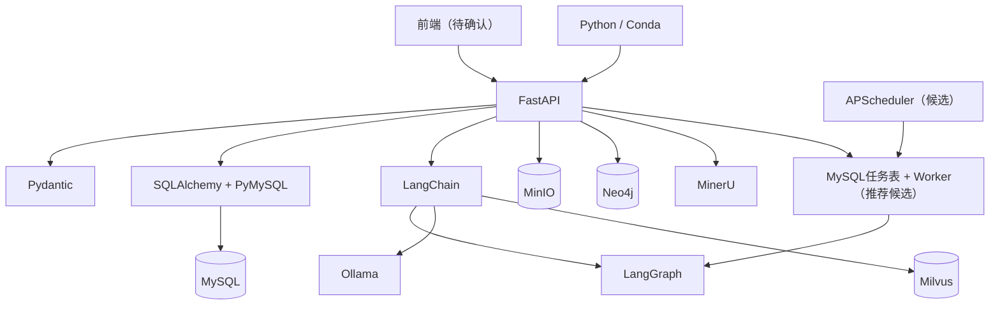

# 02_基础技术组件可行性评估

- **项目名称：** 2026 AI 数字化人才平台
- **所属阶段：** 第二阶段——技术可行性评估
- **步骤编号：** 02
- **文档类型：** 基础技术组件可行性评估报告
- **版本：** V1.1
- **评估状态：** 技术选型建议已由用户确认，待后续专项验证
- **评估依据：**
  - 《00_已有开发环境与技术选型清单.md》
  - 《第二阶段_技术可行性评估总流程.md》
  - 《02_总体技术架构可行性评估.md》
  - 《03_数据设计说明.md》
- **评估原则：** 优先复用已有技术；区分已安装、已部署和已验证状态；用户已确认本报告中的推荐方案；不将其他项目的业务设计直接迁移到本项目。

---

## 一、评估目标与范围
> **文件存储选型调整：** 本期人才平台业务文件初期采用本地文件系统，MinIO 不作为业务文件存储必选组件。现有 Milvus Standalone 部署中出现的 MinIO 属于向量数据库部署依赖，应与人才平台业务文件存储分开看待。业务代码通过统一文件存储接口访问文件，未来需要多实例共享或对象存储能力时再评估 MinIO。


### 1.1 评估目标

本步骤根据已经确认的总体技术架构和现有开发环境，评估基础技术组件是否能够支撑 AI 数字化人才平台当前七大业务领域，并形成可落地的技术选型建议。

本步骤重点回答：

1. 已有 Python、FastAPI、LangChain、LangGraph 等技术能否继续作为平台基础。
2. 前端框架是否已经确定，是否需要补充选型。
3. MySQL、Milvus、MinIO、Neo4j 的职责和部署是否适合当前平台。
4. 当前明确不使用 Redis 时，缓存、异步任务和任务调度如何实现。
5. Ollama 本地模型是否适合平台各类 AI 场景，是否需要保留外部模型接入能力。
6. 各组件之间是否存在版本、接口、资源和运维方面的风险。
7. 哪些组件可以直接沿用，哪些需要实测，哪些仍需确认。

### 1.2 评估范围

| 类别 | 本次评估对象 |
|---|---|
| 开发环境 | Windows、Python、Conda、GPU |
| 前端 | 管理端、业务端、角色化工作台 |
| 后端 | Python、FastAPI、Pydantic、API 组织 |
| Agent 与工作流 | LangChain、LangGraph |
| 数据访问 | SQLAlchemy、PyMySQL |
| 关系型数据库 | MySQL |
| 向量数据库 | Milvus、PyMilvus、LangChain Milvus |
| 图数据库 | Neo4j |
| 文件存储 | 本地文件系统（初期）；MinIO 作为未来可选扩展 |
| 缓存 | Redis 不使用时的替代策略 |
| 异步任务 | 持久化任务、Worker、队列候选方案 |
| 任务调度 | 定时、周期、手动和事件触发 |
| 模型服务 | Ollama、本地模型、外部模型适配 |
| 文档处理 | MinerU、Markdown、DOCX 解析组件 |
| 部署与运维 | Windows 本地开发、Docker 服务、日志、监控和备份 |

### 1.3 不在本步骤内完成的工作

- 不开发前端页面或完整业务接口。
- 不创建正式业务数据库表。
- 不实现简历解析、人才匹配、人才画像或测评评分业务。
- 不实现完整 Agent、Workflow 和数字员工。
- 不执行生产部署或正式性能压测。
- 不把尚未实测的组件标记为已验证。
- 不将银行 IT 智能运维 Agent 项目的业务模块、表结构和诊断工具迁移到人才平台。

---

## 二、现有技术基线

### 2.1 已有开发环境

以下内容来自《00_已有开发环境与技术选型清单.md》，保留原文件中的状态说明。

| 项目 | 已有记录 | 当前评估 |
|---|---|---|
| 操作系统 | Windows，具体版本未在该文件中记录 | 可作为当前开发环境；正式运行环境另行评估 |
| 项目根目录 | `D:\AI\Agent` | 已有记录；需确认是否继续作为人才平台根目录 |
| 开发语言 | Python | 保留 |
| 环境管理 | Conda | 保留 |
| Conda 环境 | `feiyu` | 保留；开发前复核依赖 |
| Python | 3.11.18 | 历史环境记录，需以当前实际输出为准 |
| GPU | NVIDIA GeForce RTX 5060 8GB | 已记录硬件信息；具体模型负载需实测 |
| NVIDIA 驱动 | 573.22 | 已记录 |
| 驱动报告 CUDA Version | 12.8 | 不等同于已安装 CUDA Toolkit 版本 |

### 2.2 已有后端与 Agent 组件

| 技术 | 记录版本 | 原有用途 | 本项目评估 |
|---|---:|---|---|
| FastAPI | 0.162.0 | HTTP API 服务 | 保留为后端框架候选/既有选型 |
| Pydantic | 2.14.2 | 配置、请求和响应校验 | 保留 |
| LangChain | 1.4.7 | 模型、Retriever、Tools 组织 | 保留 |
| LangGraph | 1.2.19 | 有状态工作流、节点路由和状态管理 | 保留 |
| SQLAlchemy | 2.1.6 | ORM 和关系型数据库访问 | 保留 |
| PyMySQL | 1.2.3 | Python MySQL 驱动 | 保留 |
| requests | 2.34.2 | HTTP 请求 | 保留为通用 HTTP 客户端 |
| python-dotenv | 1.2.4 | 环境变量读取 | 可保留；配置体系需统一 |

**状态说明：** 以上版本来自已有技术清单的安装记录，不代表当前环境已完成兼容性测试，也不代表平台业务功能已实现。后续开发前应导出当前环境依赖并执行依赖检查和最小集成测试。

### 2.3 已有文档处理与 RAG 组件

| 技术 | 记录版本/信息 | 原有用途 | 本项目评估 |
|---|---|---|---|
| MinerU | 4.x，具体版本待复核 | PDF 版面、正文、表格和复杂文档解析 | 保留；可用于简历及业务文件解析，具体场景在人才业务专项评估 |
| markdown-it-py | 4.2.0 | Markdown 结构解析 | 保留 |
| python-docx | 1.2.0 | DOCX 内容读取 | 保留 |
| pypdf | 6.21.4 | PDF 辅助处理 | 保留为辅助组件 |
| pdfplumber | 0.11.10 | PDF 辅助处理 | 保留为辅助组件 |
| tiktoken | 0.14.0 | Token 计算 | 可保留，具体模型 Token 兼容性需确认 |
| PyMilvus | 3.0.2 | Python 连接 Milvus | 保留，需与 Milvus Server 实测 |
| LangChain Milvus | 0.4.0 | LangChain 对接 Milvus | 保留，需集成测试 |
| LangChain Ollama | 1.1.0 | LangChain 对接 Ollama | 保留，需集成测试 |
| LangChain Text Splitters | 1.1.3 | 文本切片 | 可保留；切片策略由业务专项确定 |

### 2.4 已有数据存储与模型服务

| 组件 | 已有记录 | 当前状态判断 |
|---|---|---|
| MySQL | Community Server 8.0.44，Windows 服务，端口 3306 | 有部署记录；当前连接需实测 |
| Milvus | 2.6.25，Docker Run，客户端 `127.0.0.1:19530` | 有部署和 Server 连接记录；当前容器状态需检查 |
| MinIO | 随 Milvus Standalone 部署记录出现 | 有容器部署记录；是否已作为平台业务文件存储完成独立配置，尚未确认 |
| etcd | 随 Milvus Standalone 部署记录出现 | Milvus 相关依赖；当前容器状态需检查 |
| Neo4j | 人才平台数据设计要求使用 | 现有技术清单未提供已安装或部署证据，不能认定为已部署 |
| Ollama | 0.40.13，API `http://127.0.0.1:11434` | 有服务和端口记录；当前运行状态需复核 |
| 对话模型 | `qwen3.5:4b` | 已有模型记录；实际响应质量、速度和资源占用需测试 |
| Embedding | `qwen3-embedding:0.6b`，1024 维 | 已有模型记录；需验证与 Milvus Collection 维度一致 |

### 2.5 现有技术与本项目业务的适配边界

已有技术清单原本服务于银行 IT 智能运维 Agent，人才平台可以复用通用基础组件，但不能直接复用原项目业务定义。

| 可复用内容 | 不应直接迁移的内容 |
|---|---|
| Python、Conda、FastAPI | 银行 IT 运维业务流程 |
| LangChain、LangGraph | 知识问答 Agent、故障诊断 Agent 的既有业务定义 |
| SQLAlchemy、PyMySQL、MySQL | `agent_service` 中旧项目专属业务表及数据结构 |
| Milvus、Embedding、RAG 组件 | 旧项目技术文档 Chunk 的 Collection 结构和检索字段 |
| Ollama 模型服务 | 旧项目 Prompt、模型调用参数和评估结论 |
| MinerU 及文件解析工具 | 旧项目文档分类、切片规则和解析结果 Schema |
| Docker 运行 Milvus 的经验 | 旧项目容器组合不经评估直接作为人才平台部署方案 |

**重要说明：** 原技术清单中的 MySQL 数据库名 `agent_service` 是旧项目配置记录，不代表人才平台应沿用该数据库名或旧项目业务表。人才平台应单独确定数据库名称、Schema、账号和权限。

---

## 三、基础技术组件评估总表

| 编号 | 技术类别 | 当前方案/已有组件 | 推荐结论 | 处理方式 |
|---|---|---|---|---|
| C-01 | 开发语言 | Python 3.11.18 | 可行 | 保留，复核环境 |
| C-02 | 前端框架 | 现有清单未记录 | 待确认 | 单独开展前端选型 |
| C-03 | 后端框架 | FastAPI 0.162.0 | 可行 | 保留，做最小接口验证 |
| C-04 | 数据校验 | Pydantic 2.14.2 | 可行 | 保留 |
| C-05 | ORM | SQLAlchemy 2.1.6 | 可行 | 保留，确定事务和 Repository 规范 |
| C-06 | MySQL 驱动 | PyMySQL 1.2.3 | 可行 | 保留，连接和事务实测 |
| C-07 | Agent 框架 | LangChain 1.4.7 | 可行 | 保留 |
| C-08 | Workflow 框架 | LangGraph 1.2.19 | 可行 | 保留，Checkpoint 和恢复专项验证 |
| C-09 | 关系型数据库 | MySQL 8.0.44 | 可行 | 保留为业务主数据库 |
| C-10 | 向量数据库 | Milvus 2.6.25 | 有条件可行 | 保留，人才数据 Collection 另行设计 |
| C-11 | 图数据库 | Neo4j | 目标组件已确认 | 纳入目标数据架构；在人才关系查询专项中验证部署范围和实际使用价值 |
| C-12 | 业务文件存储 | 本地文件系统 | 已确认采用 | 初期采用本地文件系统，通过统一 FileStorage 接口封装；MinIO 仅作为未来扩展选项 |
| C-13 | 缓存 | Redis 暂不使用 | 可行 | 初期不引入独立缓存 |
| C-14 | 异步任务 | MySQL 持久化任务表 + 独立 Worker | 已确认采用 | 作为初期异步任务执行方案；具体锁、幂等和恢复机制进入详细设计 |
| C-15 | 任务调度 | APScheduler + MySQL 任务表 + Worker | 已确认采用 | APScheduler 负责定时/周期触发，Worker 负责执行，任务状态持久化到 MySQL |
| C-16 | 模型服务 | Ollama + 统一模型适配层 | 已确认采用 | 本地模型优先，保留外部模型接入能力；生产模型能力仍需业务样本验证 |
| C-17 | 文档解析 | MinerU 4.x + 原生格式解析器 | 有条件可行 | 保留，解析能力在人才业务专项评估 |
| C-18 | 容器服务 | Docker Run | 可行 | 保留现有使用方式；整体部署方案后续评估 |
| C-19 | 监控与可观测性 | 现有清单未确认完整方案 | 待确认 | 评估日志、Trace、指标和告警方案 |
| C-20 | API 文档 | FastAPI OpenAPI 能力 | 可行 | 作为接口文档基础，权限控制需另行设计 |

---

## 四、前端框架与工作台实现方式

### 4.1 当前情况

现有技术清单没有记录已经确定或安装的前端框架，因此不能把 Vue、React 或其他框架写成已有技术。

人才平台需要统一平台入口，并根据候选人、员工、HR、业务人员、管理层和平台管理员等角色展示不同工作台和功能。

### 4.2 候选方案比较

| 方案 | 优势 | 限制 | 适用情况 |
|---|---|---|---|
| Vue 3 + TypeScript | 组件化成熟，管理后台生态完善，团队学习和维护成本相对可控 | 仍需确定组件库、状态管理、路由和工程规范 | 管理后台和业务工作台 |
| React + TypeScript | 生态丰富，复杂交互和组件复用能力强 | 需要统一团队代码规范和状态管理方案 | 复杂交互、生态扩展需求较多的项目 |
| 服务端模板 | 架构简单，前端工程成本低 | 复杂工作台、动态交互和角色化界面开发体验受限 | 简单内部工具，不适合作为本平台长期主方案 |

### 4.3 推荐建议

**建议优先评估 Vue 3 + TypeScript。**

理由：
- 本平台以业务管理、表单、列表、流程状态、权限菜单和数据看板为主要界面。
- 角色化工作台需要大量复用表格、表单、弹窗、状态展示和权限组件。
- 前后端分离已经在总体架构中确定。
- Vue 3 + TypeScript 能够满足当前复杂度，避免引入过多前端工程复杂度。

可进一步评估 Element Plus 等管理端组件库，但组件库尚未作为已确认选型。

### 4.4 前端架构要求

- 使用统一登录和路由入口。
- 根据用户角色、功能权限和数据范围显示功能。
- 前端权限控制仅用于界面展示，后端必须再次鉴权。
- API 请求统一封装，处理认证、异常、分页和文件上传。
- 统一表单校验、状态展示和操作审计交互。
- 候选人端、员工端和内部管理端可以共享基础组件，但按业务场景组织页面。

**结论：已确认采用 Vue 3 + TypeScript。** 当前已有技术清单没有前端选型证据，因此该项属于本次新增并经用户确认的技术选型。Element Plus 可作为管理端组件库候选，具体版本在前端工程初始化时锁定。

---

## 五、后端框架与 API 技术评估

### 5.1 Python + FastAPI

**已有记录：** Python 3.11.18、FastAPI 0.162.0、Pydantic 2.14.2。

**主要用途：**
- 提供统一 HTTP API。
- 接收前端业务请求。
- 身份认证和请求上下文传递。
- 调用业务服务、AI 中台和任务服务。
- 提供文件上传、任务查询和结果查询接口。
- 生成 OpenAPI 接口文档。

**优势：**
- 与现有 Python、LangChain、LangGraph 技术栈一致。
- Pydantic 可用于请求、响应和配置校验。
- 适合将业务接口与 Agent/Workflow 服务集成。
- 支持异步接口及依赖注入等 Web 服务能力。

**限制与注意事项：**
- `async` 接口不代表所有底层操作都自动异步；同步数据库驱动和耗时模型调用仍可能阻塞执行线程。
- 不应在 HTTP 请求生命周期中直接执行长时间简历解析、批量匹配和报告生成。
- 需要明确 API、业务服务、Repository 和 AI 服务之间的职责。
- 必须增加认证、数据权限、异常处理、请求追踪和限流等能力。

### 5.2 API 组织建议

```text
app/
├── main.py
├── core/
│   ├── config.py
│   ├── logging.py
│   ├── security.py
│   └── exceptions.py
├── api/
│   ├── dependencies/
│   ├── middleware/
│   └── v1/
│       ├── auth/
│       ├── talent/
│       ├── recruitment/
│       ├── assessment/
│       ├── agent/
│       ├── digital_employee/
│       ├── analytics/
│       └── organization/
├── modules/
│   ├── talent/
│   ├── recruitment/
│   ├── assessment/
│   ├── agent_platform/
│   ├── digital_employee/
│   ├── analytics/
│   └── identity/
├── ai/
│   ├── models/
│   ├── agents/
│   ├── workflows/
│   └── tools/
├── tasks/
├── database/
└── schemas/
```

以上为建议组织方式，不代表必须立即创建全部目录，也不改变第一阶段已确认的业务模块边界。

### 5.3 推荐结论

**可行，保留 Python + FastAPI + Pydantic。**

下一步应进行依赖版本复核、应用入口验证、健康检查和 MySQL 最小连接测试；本步骤不提前执行代码开发。

---

## 六、Agent 与 Workflow 技术评估

### 6.1 LangChain

已有版本记录：1.4.7。

适合承担：
- 模型调用封装。
- Prompt 组织。
- Tool 定义和调用接口。
- Retriever 和向量检索集成。
- 结构化输出及结果解析。
- AI 中台内部的组件组织。

限制：
- 不应将所有业务规则写入 Prompt。
- 不应让 Agent 直接维护正式业务状态。
- 工具必须进行参数校验、身份授权和执行审计。
- 模型输出必须经过结构化校验和业务规则检查。

### 6.2 LangGraph

已有版本记录：1.2.19。

适合承担：
- 有状态 Workflow。
- 节点、边和条件路由。
- 多 Agent 或多个工具步骤的组织。
- 固定主流程与动态分支组合。
- 中断、人工确认和恢复。
- Checkpoint 和执行状态管理。

限制：
- 已安装不代表 StateGraph、Checkpoint、持久化和恢复已经实现。
- Workflow 状态与正式业务状态应分离。
- 恢复执行必须识别已成功节点，避免重复副作用。
- Checkpoint 存储方式需要与任务执行层及数据持久化策略配合设计。

### 6.3 两者分工

| 组件 | 主要职责 | 不负责的内容 |
|---|---|---|
| LangChain | 模型、Retriever、Tools 和 Agent 组件组织 | 不单独承担完整业务状态机和任务调度 |
| LangGraph | Workflow 状态、节点、路由、中断和恢复 | 不替代业务数据库和业务服务 |
| FastAPI | 对外 API 和服务接入 | 不替代 Agent 内部执行框架 |
| MySQL | 业务数据、任务元数据及需要持久化的结构化记录 | 不替代 Workflow 执行引擎 |

### 6.4 推荐结论

**可行，保留 LangChain + LangGraph。**

建议由 LangChain 负责 Agent 组件和工具组织，由 LangGraph 负责多步骤、有状态的执行流程。任务调度、业务状态和权限仍由平台自身服务负责。

---

## 七、关系型数据库与数据访问方案

### 7.1 MySQL 8.0.44

已有记录：
- MySQL Community Server 8.0.44。
- Windows 本地服务 `MySQL80`。
- 地址 `127.0.0.1`。
- 端口 `3306`。
- 原项目配置数据库名 `agent_service`。

人才平台使用 MySQL 作为结构化业务主数据库，适合保存：
- 用户、部门、角色和权限。
- 项目群、项目、项目需求和岗位。
- 人才主档案、候选人和员工身份。
- 简历元数据、解析结果和匹配结果。
- 画像草稿、正式版本和变更记录。
- 题库、试卷、答卷、评分、测评和面试记录。
- Agent、Workflow、数字员工和任务元数据。
- 审批及审计记录。

**评估结论：可行，保留 MySQL 8.0.44。**

### 7.2 数据访问方案

建议沿用：
- SQLAlchemy：ORM、事务管理和数据访问抽象。
- PyMySQL：Python MySQL 驱动。
- Pydantic：API 数据结构和参数校验。

建议分层：

```text
API Router
    │
    ▼
Application Service
    │
    ▼
Domain / Business Logic
    │
    ▼
Repository
    │
    ▼
SQLAlchemy
    │
    ▼
PyMySQL
    │
    ▼
MySQL
```

### 7.3 关键约束

- 人才平台使用独立数据库和独立数据库账号。
- 不沿用旧项目业务表。
- 密码只从本地环境配置或密钥管理方式读取，不写入代码和日志。
- 明确事务边界，避免跨模块随意共享数据库 Session。
- 业务主数据以 MySQL 为准。
- 对任务状态、审计记录和业务状态变更建立必要的索引与唯一性约束。
- 数据库连接池、事务隔离、连接超时和慢查询策略在详细设计阶段确认。

### 7.4 推荐结论

**可行，保留 MySQL + SQLAlchemy + PyMySQL。**

数据库名 `agent_service` 属于旧项目记录，不作为人才平台数据库名的既定结论。

---

## 八、向量数据库与图数据库评估

### 8.1 Milvus 2.6.25

已有记录：
- Milvus 2.6.25。
- Docker Run 部署。
- 客户端 `127.0.0.1:19530`。
- HTTP 管理/健康端口 `127.0.0.1:9091`。
- PyMilvus 3.0.2。
- LangChain Milvus 0.4.0。

适用场景：
- 人才和简历语义向量检索。
- 岗位描述与人才能力语义匹配。
- 人才画像相关语义检索。
- 其他明确需要相似度检索的场景。

不适合：
- 保存人才档案权威数据。
- 保存正式招聘状态和测评成绩。
- 代替 MySQL 承担业务事务。

注意事项：
- Embedding 模型维度为 1024，Milvus Collection 的向量维度必须一致。
- 需要设计人才、简历、岗位向量的元数据和业务对象标识。
- 需要定义模型变更后向量重建策略。
- 需要定义数据更新、删除和重建索引流程。
- 当前清单中的 RAG 技术知识 Chunk Collection 不能直接视为人才平台 Collection 设计。

**结论：有条件可行，保留 Milvus 2.6.25。** 需在人才业务专项评估中确定向量化对象、检索策略和评测集。

### 8.2 Neo4j

人才平台数据设计要求 Neo4j 保存人才、技能和岗位之间的关系。

适用场景：
- 人才与技能关系。
- 技能与岗位能力要求关系。
- 人才与岗位关联关系。
- 多跳关系查询及关系分析。

限制：
- 现有技术清单未证明 Neo4j 已安装、部署或完成连接测试。
- 当前关系数据规模和复杂查询需求尚未量化。
- 需要维护 MySQL 与 Neo4j 的同步及一致性。
- 如果初期关系查询较简单，可以先通过 MySQL 关联表实现，待图关系分析确实产生价值后再启用 Neo4j；但这需要与已确认的数据设计基线协调，不能擅自删除既定组件。

**结论：已确认将 Neo4j 纳入人才平台目标数据架构。** 具体部署时机、版本和实际启用范围，在人才关系查询专项中验证；若验证发现当前关系查询可由 MySQL 充分满足，应提交架构变更建议，不擅自删除已确认的数据设计要求。

### 8.3 Milvus 与 Neo4j 的职责边界

| 组件 | 负责 | 不负责 |
|---|---|---|
| MySQL | 业务主数据和正式业务状态 | 高维向量相似度检索、复杂图遍历 |
| Milvus | 向量存储和相似度检索 | 人才主档案和招聘状态 |
| Neo4j | 实体关系及图遍历 | 业务事务主数据 |
| 本地文件系统 | 初期保存原始文件及附件 | 结构化业务查询 |

---

## 九、文件存储与文档处理组件评估

### 9.1 业务文件存储：初期采用本地文件系统

现有清单中 MinIO 出现在 Milvus Standalone 的部署依赖记录中，但这不能证明人才平台已经需要或必须使用 MinIO 作为业务文件存储。

人才平台需要保存简历原件、人才附件、测评附件和生成报告。结合初期注册用户 100 人以内、同时在线 20 人以内的规模，初期建议采用**本地文件系统**，暂不额外部署业务 MinIO。

建议：
- 通过统一 `FileStorage` 抽象接口提供上传、下载、删除和元数据访问能力。
- 文件按业务类型、业务对象和版本组织存储路径，避免由用户输入直接决定磁盘路径。
- MySQL 保存文件名称、大小、类型、存储标识、版本、所属业务对象及访问权限关联，不将文件二进制内容存入业务表。
- 文件下载必须经过后端鉴权，不暴露未经授权的磁盘路径。
- 文件上传限制类型、大小和数量，并进行内容与格式校验。
- 配置文件目录访问权限、磁盘容量监控、备份和恢复流程。
- 删除业务数据时，按数据生命周期规则同步清理本地文件，并记录清理结果。
- 未来如需多实例共享、独立扩容或对象存储能力，可在不改变业务模块调用方式的前提下，将 `FileStorage` 实现切换为 MinIO 或其他对象存储。

**结论：已确认初期采用本地文件系统。** MinIO 不作为人才平台业务文件存储的必选组件，仅保留为未来扩展选项。Milvus 自身部署所需的对象存储依赖单独管理，不与业务文件存储混为一谈。

### 9.2 MinerU 与其他解析组件

已有解析方案：
- PDF 优先使用 MinerU 本地 HTTP API。
- Markdown 使用 markdown-it-py。
- DOCX 使用 python-docx。
- pypdf、pdfplumber 作为 PDF 辅助处理组件。
- 不同解析器通过统一入口分发，输出统一解析结构。

本项目中可能处理简历、JD、测评附件和其他业务文件。不同文件的解析要求不完全相同，是否全部采用 MinerU 需在人才业务核心技术评估中确认。

**结论：有条件可行，保留现有解析技术方向，不在本步骤确定人才业务解析规则。**

### 9.3 文件处理链路建议

```text
前端上传
   │
   ▼
FastAPI 文件接收与基础校验
   │
   ▼
本地文件系统保存原文件
   │
   ├── MySQL 保存文件元数据和业务关联
   │
   ▼
创建持久化解析任务
   │
   ▼
Worker 调用对应解析器
   │
   ▼
统一解析结构与质量检查
   │
   ▼
业务模块接收待确认结果
```

长耗时解析不应占用普通 API 请求处理过程。

---

## 十、缓存技术评估：本期不使用 Redis

### 10.1 当前约束

数据设计已明确：
- 当前暂不使用 Redis。
- 不将 Redis 作为本期缓存、会话或任务队列的前置依赖。
- 原始需求中出现 Redis 不代表本期仍需部署。

本报告按该约束评估，不将 Redis 列为推荐必选组件。

### 10.2 初期是否需要独立缓存

初期规模：
- 注册用户 100 人以内。
- 同时在线用户 20 人以内。

当前可以优先采用：
- MySQL 直接读取结构化业务数据。
- 合理设计索引和分页。
- 对稳定且低频变化的配置，在应用进程内使用短时缓存。
- 不缓存权限判定结果，或采用极短有效期并保证权限变更可及时生效。
- 会话采用经确认的认证机制，不以 Redis 为前置条件。

### 10.3 替代方案对比

| 方案 | 优势 | 限制 | 当前建议 |
|---|---|---|---|
| 不设置独立缓存 | 架构简单，少一个服务依赖 | 高频重复读取时数据库压力增加 | 初期优先采用 |
| 应用进程内缓存 | 不需要额外基础设施 | 多进程/多实例之间不共享，失效管理较弱 | 仅缓存非敏感、低频变化配置 |
| MySQL 查询优化 | 数据一致性较容易管理 | 不适合承担高频临时数据缓存 | 作为主要优化手段 |
| Redis | 高性能共享缓存、队列等能力 | 增加部署和维护成本，且与当前约束冲突 | 本期不采用 |

### 10.4 推荐结论

**可行，本期不引入 Redis。**

先通过数据库索引、分页、连接池和必要的进程内配置缓存满足初期规模。后续只有出现明确性能瓶颈或共享缓存需求时，才重新评估缓存组件，并重新确认是否调整“不使用 Redis”的约束。

---

## 十一、异步任务与消息队列评估

### 11.1 业务对异步能力的要求

人才平台存在以下耗时或需要后台执行的任务：
- 批量简历解析，单批最多 20 份。
- 人才匹配及批量匹配。
- AI 人才画像生成。
- 主观题 AI 评分。
- 批量通知或邀请处理。
- 报告生成。
- Workflow 执行。
- 定时和周期任务。

Agent 单次任务最长执行时间为 2 分钟。长耗时任务不能全部放在普通 HTTP 请求中同步等待。

### 11.2 候选方案比较

| 方案 | 优势 | 限制 | 与当前约束的关系 |
|---|---|---|---|
| MySQL 持久化任务表 + 独立 Worker | 不增加新的消息中间件；任务状态可直接持久化；适合当前小规模 | 需要自行设计任务领取、锁、重试、并发和恢复机制；高吞吐能力有限 | 最符合当前规模及暂不使用 Redis 的约束 |
| RabbitMQ + Worker | 消息投递、确认和队列能力成熟 | 增加部署、监控和维护成本；需处理消息与业务数据库一致性 | 可作为未来备选，不建议初期直接引入 |
| Redis + Celery | 生态成熟，异步任务能力丰富 | 与本期不使用 Redis 的约束冲突 | 不采用 |
| 仅依赖 FastAPI BackgroundTasks | 实现简单 | 不适合需要可靠持久化、重试、服务重启恢复的关键业务任务 | 不作为核心任务执行方案 |

### 11.3 推荐方案

**初期优先采用 MySQL 持久化任务表 + 独立 Worker。**

建议逻辑：

```text
业务模块创建任务
      │
      ▼
MySQL 持久化任务记录
      │
      ▼
Worker 定期领取待执行任务
      │
      ▼
执行简历解析 / AI任务 / 报告生成
      │
      ├── 成功：更新任务状态和结果
      │
      ├── 失败：记录错误并按策略重试
      │
      ├── 超时：标记超时并进入恢复流程
      │
      └── 等待人工：保存状态并等待处理
```

需要重点设计：
- 任务唯一标识和幂等键。
- 任务状态及状态转换。
- 任务领取锁或租约。
- 任务超时与 Worker 崩溃后的重新领取。
- 最大重试次数和重试间隔。
- 任务优先级及并发限制。
- 取消、暂停、恢复和终止。
- 任务与业务对象、用户、Agent、Workflow 的关联。
- 权限撤销后的任务中止或限制后续工具调用。
- 任务执行日志和审计记录。

### 11.4 方案限制

MySQL 任务表方案不是高吞吐消息队列的等价替代品。需要通过领取锁、短事务、索引、轮询间隔和 Worker 并发控制，避免多个 Worker 重复领取任务或造成数据库压力。

如果后续任务量、并发或可靠性要求明显增加，再评估 RabbitMQ 等消息中间件。

### 11.5 推荐结论

**有条件可行。**

推荐 MySQL 持久化任务表 + 独立 Worker 作为初期候选实现。具体任务表结构、Worker 技术、领取锁策略和调度机制仍需在第 6 步数字员工与任务调度技术评估中细化。

---

## 十二、定时、周期与手动任务调度评估

### 12.1 调度需求

平台需要支持：
- 用户手动触发任务。
- 按指定时间执行。
- 按周期重复执行。
- 由业务事件触发。
- 暂停、恢复、取消和终止。
- 执行记录查询及失败处理。

### 12.2 调度与执行必须分离

调度器只负责判断“什么时候应该创建任务”，Worker 负责“如何执行任务”。

```text
定时 / 周期 / 手动 / 业务事件
             │
             ▼
         调度服务
             │
             ▼
      创建持久化任务
             │
             ▼
       MySQL 任务记录
             │
             ▼
          Worker
             │
             ▼
      Agent / Workflow
             │
             ▼
       业务服务校验
             │
             ▼
        保存业务结果
```

### 12.3 候选调度方案

| 方案 | 优势 | 限制 | 当前建议 |
|---|---|---|---|
| APScheduler | Python 集成方便，适合定时和周期触发 | 多实例下需要避免重复调度；任务持久化和执行可靠性需与任务表配合 | 可作为初期调度器候选 |
| 操作系统计划任务 | 部署简单，适合固定脚本 | 不适合复杂业务任务管理、动态任务和统一审计 | 仅用于运维脚本，不作为平台主调度器 |
| Celery Beat | 与 Celery 任务体系结合 | 常见部署依赖消息代理，与当前不使用 Redis 的约束需要额外方案 | 暂不推荐 |
| 自建数据库调度轮询 | 与 MySQL 任务表统一 | 需要自行实现周期计算、锁和调度恢复 | 可与任务表方案结合，但开发维护成本更高 |

### 12.4 推荐建议

初期可评估 **APScheduler 负责定时/周期触发 + MySQL 任务表负责任务持久化 + 独立 Worker 负责执行**。

必须明确：
- 调度器不能直接承担耗时 AI 任务。
- 多进程或多实例部署时必须防止重复触发。
- 调度规则、下次执行时间和执行历史需要持久化。
- 手动触发也应进入统一任务体系。
- 业务事件触发不应依赖定时轮询来模拟所有实时场景。
- 任务执行失败由任务执行层处理，不由调度器无限重试。

**结论：已确认采用 APScheduler 作为初期定时/周期调度候选实现。** APScheduler 只负责触发任务，不直接承担耗时 AI 任务；任务持久化由 MySQL 负责，实际执行由独立 Worker 负责。多进程/多实例下的防重复触发和故障恢复仍需专项验证。

---

## 十三、模型供应商与模型服务适配

### 13.1 现有 Ollama

已有记录：
- Ollama 0.40.13。
- 本地 API：`http://127.0.0.1:11434`。
- 对话模型：`qwen3.5:4b`。
- Embedding 模型：`qwen3-embedding:0.6b`。
- Embedding 维度：1024。
- GPU：RTX 5060 8GB。

### 13.2 适用场景分析

| 场景 | 本地 Ollama 适用性 | 说明 |
|---|---|---|
| 简历文本结构化辅助 | 有条件适用 | 需测试长文本、字段准确率和结构化输出稳定性 |
| 人才匹配解释 | 有条件适用 | 规则过滤应由业务代码完成，模型负责语义辅助和解释 |
| 人才画像草稿 | 有条件适用 | 需要评估长上下文和事实依据能力 |
| 主观题评分 | 有条件适用 | 必须有评分标准、人工复核和一致性评估 |
| JD 草稿生成 | 适用候选 | 需要 HR 审核 |
| Embedding | 适用候选 | 1024 维需与 Milvus 配置一致 |
| 高并发批量任务 | 需验证 | 8GB 显存限制下需控制并发和模型常驻情况 |
| 关键业务决策 | 不应由模型单独完成 | 必须由业务规则和授权人员控制 |

### 13.3 本地模型的优势和限制

优势：
- 数据可以在本地推理环境处理，减少向外部模型服务发送数据的需求。
- 不依赖每次调用外部模型 API 的网络可用性。
- 便于控制模型版本和开发测试环境。
- 可用于开发、验证和部分低并发业务任务。

限制：
- GPU 显存只有 8GB，模型大小、上下文长度和并发会影响性能。
- 模型推理速度和结构化输出质量必须按真实业务样本验证。
- 单个本地模型服务可能成为多个 AI 任务的资源竞争点。
- 模型升级、量化和参数变化可能影响结果一致性。
- 不能假设本地模型一定比外部模型更快或更准确。

### 13.4 模型适配层建议

建议统一抽象：
- Chat Model 接口。
- Embedding 接口。
- 模型供应商配置。
- 模型名称和版本配置。
- 超时、重试和并发限制。
- Token/耗时/错误记录。
- 个人信息传输策略。
- 模型调用审计。

业务模块和 Agent 不直接硬编码 Ollama 地址及模型名称。

### 13.5 外部模型备选

可保留外部模型供应商接入能力，但不在本步骤直接确定具体供应商。

选择外部模型时，需要评估：
- 数据是否允许出域。
- 候选人个人信息是否需要脱敏。
- API 可用性和响应时延。
- 费用及调用限额。
- 模型能力和结构化输出质量。
- 密钥管理、调用审计和供应商故障降级。

### 13.6 推荐结论

**有条件可行。**

保留 Ollama 作为本地模型服务和开发验证方案；通过统一模型适配层保留后续外部模型接入能力。是否将本地模型作为生产环境唯一模型，需要结合人才业务、测评和 Agent 专项评估及实测结果确认。

---

## 十四、部署方式与运行环境评估

### 14.1 当前已有部署方式

| 组件 | 已有方式 | 本项目建议 |
|---|---|---|
| Python 应用 | Windows + Conda `feiyu` | 继续用于开发和本地验证 |
| FastAPI | Python 进程运行 | 开发期本地运行；生产部署方式后续确认 |
| MinerU | Conda + pip 本地服务 | 继续独立运行，通过 HTTP API 调用 |
| Ollama | 本地服务 | 作为模型服务独立运行 |
| MySQL | Windows 本地服务 | 继续作为本地开发数据库 |
| Milvus | Docker Run | 保留当前部署经验 |
| MinIO / etcd | Docker 容器记录 | 检查容器及数据持久化配置 |
| Neo4j | 未有明确部署记录 | 待评估部署形态 |
| 前端 | 未记录 | 待选型 |

### 14.2 开发环境与运行环境分离

开发环境可以继续采用 Windows + Conda + Docker 的组合，但不能默认生产环境也必须使用相同方式。

后续需要确认：
- 生产运行操作系统。
- 应用部署方式。
- 数据库及对象存储部署方式。
- 模型服务部署位置。
- 是否需要容器化应用服务。
- 服务启动顺序和健康检查。
- 配置、密钥、日志和数据卷管理。
- 备份、恢复和升级流程。

### 14.3 Docker Run 与 Compose

当前 Milvus 已有 Docker Run 部署记录。是否在整个平台部署时采用 Docker Compose，应根据服务数量、依赖关系、启动顺序和运维需求统一评估。

本步骤不强制把已有 Docker Run 改为 Compose，也不把 Docker Compose 作为所有服务的必选部署方式。

### 14.4 推荐结论

**有条件可行。**

开发期沿用已有本地环境；生产部署拓扑暂不确定，留待综合技术评估和实施阶段确认。

---

## 十五、组件依赖关系

### 15.1 逻辑依赖图



### 15.2 依赖说明

- FastAPI 是统一 API 接入层。
- Pydantic 负责请求、响应和配置校验。
- SQLAlchemy + PyMySQL 访问 MySQL。
- LangChain 组织模型、工具和检索组件。
- LangGraph 组织有状态 Workflow。
- Ollama 提供本地模型和 Embedding 服务。
- Milvus 提供向量检索。
- 本地文件系统保存业务原文件和附件。
- Neo4j 提供人才、技能、岗位关系查询。
- MinerU 负责复杂文档解析。
- 任务执行层与调度器通过持久化任务记录协作。

图中前端、Neo4j 部署、任务执行方案和调度器仍有待确认内容；该图表示建议依赖关系，不表示所有组件均已部署或通过集成测试。

---

## 十六、版本兼容、资源与维护风险

### 16.1 版本兼容性

当前技术清单中的版本均应以实际环境复核为准。需要重点验证：

1. Python 3.11.18 与 FastAPI、Pydantic、LangChain、LangGraph 的实际依赖兼容性。
2. SQLAlchemy 2.1.6 与 PyMySQL 1.2.3 的连接、事务和 ORM 行为。
3. PyMilvus 3.0.2 与 Milvus Server 2.6.25 的客户端兼容性。
4. LangChain Milvus 0.4.0 与当前 LangChain 主版本的集成方式。
5. LangChain Ollama 1.1.0 与 Ollama 0.40.13 的 API 兼容性。
6. MinerU 4.x 的实际 API 路径、参数、响应和模型依赖。
7. Neo4j Python Driver 与目标 Neo4j Server 版本（版本尚未确定）。
8. 前端 Node.js、包管理器和组件库版本（尚未确定）。

不能仅依据包已安装或服务端口曾经监听就判断兼容性通过。

### 16.2 资源占用风险

| 资源 | 主要占用来源 | 风险 | 建议 |
|---|---|---|---|
| GPU 显存 | Ollama 对话模型、Embedding、MinerU 推理 | 多模型/多任务同时运行可能发生显存竞争 | 分批执行、限制并发、监控显存 |
| CPU | PDF/DOCX 解析、OCR、向量预处理、Worker | 批量任务影响在线 API | 任务进程隔离和并发限制 |
| 内存 | Python API、Worker、模型服务、数据库容器 | 多服务同时运行可能增加内存压力 | 记录峰值内存，限制 Worker 数量 |
| 磁盘 | 简历原件、解析结果、向量库、数据库和模型文件 | 数据持续增长 | 规划数据目录、容量监控和备份 |
| 数据库连接 | API 并发、Worker、调度器 | 连接耗尽或长事务 | 连接池、超时和事务规范 |

### 16.3 运维复杂度

当前同时使用 Windows 本地服务、Conda 进程和 Docker 容器。开发期可行，但需要统一：
- 服务启动和停止说明。
- 健康检查和依赖检查。
- 日志位置和日志轮转。
- 数据持久化目录。
- 端口清单。
- 配置文件和密钥管理。
- 备份与恢复操作。
- 服务异常后的恢复步骤。

---

## 十七、基础技术选型建议

### 17.1 建议保留的已有技术

| 技术 | 建议 | 原因 |
|---|---|---|
| Python 3.11 | 保留 | 已有开发环境基础 |
| Conda `feiyu` | 保留 | 已确定的统一 Python 环境 |
| FastAPI | 保留 | 适合 API 接入及 Python AI 服务集成 |
| Pydantic | 保留 | 适合请求、响应和配置校验 |
| LangChain | 保留 | 适合模型、工具和检索组件组织 |
| LangGraph | 保留 | 适合有状态 Workflow 和中断恢复 |
| SQLAlchemy | 保留 | 适合关系型数据访问 |
| PyMySQL | 保留 | 当前 MySQL 驱动 |
| MySQL 8.0.44 | 保留 | 作为结构化业务主数据库 |
| Milvus 2.6.25 | 保留 | 满足向量检索需求 |
| 本地文件系统 | 初期采用 | 满足当前规模的原始文件和附件存储需求；通过统一接口保留对象存储扩展能力 |
| Ollama | 保留 | 本地模型服务已有基础 |
| MinerU | 保留方向 | 可用于复杂文件解析，具体业务范围后续评估 |
| markdown-it-py / python-docx | 保留 | 对应格式的轻量解析组件 |

### 17.2 建议新增或待确认的技术

| 技术类别 | 推荐候选 | 当前状态 | 说明 |
|---|---|---|---|
| 前端框架 | Vue 3 + TypeScript | 待用户确认 | 当前技术清单没有前端选型 |
| 前端组件库 | Element Plus | 待评估 | 管理端候选，不作为既定选型 |
| 图数据库 | Neo4j | 需求基线已提出，部署待确认 | 需要验证关系查询是否值得引入 |
| 异步任务 | MySQL 持久化任务表 + 独立 Worker | 推荐候选 | 符合暂不使用 Redis 的约束 |
| 定时调度 | APScheduler | 推荐候选 | 负责触发，不直接承担耗时任务 |
| 监控与追踪 | 结构化日志 + 指标/Trace 方案 | 待评估 | 先明确最小可观测性要求 |
| 通知服务 | 平台内通知/消息能力 | 待业务设计确认 | 不提前确定外部 IM 或短信供应商 |
| 认证方式 | Token/会话方案 | 待安全专项确认 | 需要结合候选人、员工和内部用户场景设计 |

### 17.3 本期明确不引入

- Redis：当前明确暂不使用。
- PgSQL：当前数据设计明确不引入。
- 以 Redis 为前置依赖的 Celery 方案：不采用。
- 全面微服务基础设施：初期没有明确必要。
- 未经业务需求证明必要的额外数据库或中间件：不引入。

---

## 十八、技术风险清单

| 编号 | 风险 | 影响 | 等级 | 建议处理 |
|---|---|---|---|---|
| T-01 | 前端框架尚未确定 | 无法形成完整前后端技术基线 | 中 | 确认 Vue 3 + TypeScript 或备选 |
| T-02 | 已记录包版本未进行完整兼容验证 | 安装成功但集成运行失败 | 高 | 锁定依赖并进行最小集成测试 |
| T-03 | MySQL `agent_service` 属于旧项目配置 | 误用旧项目数据结构 | 高 | 人才平台独立数据库和账号 |
| T-04 | Neo4j 缺少部署和版本证据 | 图关系能力无法直接使用 | 中 | 单独验证部署及实际查询价值 |
| T-05 | 本地文件存储缺少完整生命周期设计 | 文件权限、备份、恢复、磁盘容量和删除清理可能不完整 | 中 | 建立统一文件接口、访问控制、备份恢复和容量监控；未来需要时再引入 MinIO |
| T-06 | 暂不使用 Redis | 需要自行实现任务领取和并发控制 | 中 | MySQL 任务表 + Worker 候选方案 |
| T-07 | Worker 任务幂等和恢复尚未设计 | 重复执行或任务中断 | 高 | 设计幂等键、租约、重试和恢复 |
| T-08 | Ollama 与 GPU 资源有限 | 多 AI 任务并发时延迟增加 | 高 | 评估模型质量、并发和资源隔离 |
| T-09 | 模型供应商未形成统一适配层 | 模型替换影响业务代码 | 中 | 建立 Chat/Embedding 统一接口 |
| T-10 | MinerU API 细节尚未完整记录 | 文档解析集成不稳定 | 中 | 核实 API 路径、参数和响应 |
| T-11 | Milvus 与 PyMilvus 兼容性需实测 | 向量读写和检索失败 | 中 | 最小连接、写入、查询和删除测试 |
| T-12 | Neo4j 与 MySQL 数据同步未定义 | 图关系与业务主数据不一致 | 中 | 建立关联标识、同步和补偿规则 |
| T-13 | 缺少统一日志、Trace 和指标方案 | 任务失败难以定位 | 高 | 建立统一可观测性方案 |
| T-14 | Windows 开发环境与未来生产环境可能不同 | 部署行为差异 | 中 | 明确生产运行环境和部署策略 |
| T-15 | 其他项目的业务配置可能被误迁移 | 业务范围和数据结构混乱 | 高 | 只复用通用组件，不复用旧业务模型 |

---

## 十九、用户确认的技术选型决策

用户已明确表示“都按照推荐的来”，本节将本报告中提出的推荐方案转为当前项目技术选型基线。

### 19.1 前端技术：已确认

- 采用 Vue 3 + TypeScript。
- 管理端组件库优先采用 Element Plus，具体版本在前端工程初始化时锁定。
- 统一平台入口，根据角色和权限展示工作台。

### 19.2 图数据库：已确认纳入目标架构

- 保留 Neo4j，作为人才、技能和岗位关系数据的目标存储组件。
- 在人才关系查询专项中验证部署时机、版本和查询价值。
- Neo4j 的部署验证不改变 MySQL 作为业务主数据来源的原则。

### 19.3 异步任务：已确认

- 采用 MySQL 持久化任务表 + 独立 Worker。
- 任务状态持久化在 MySQL。
- Worker 负责执行解析、AI、报告等耗时任务。
- 幂等、锁、重试、超时、取消和恢复策略在任务专项设计中细化。

### 19.4 定时调度：已确认

- 采用 APScheduler 负责定时和周期触发。
- APScheduler 不直接执行耗时 AI 任务。
- 调度器创建任务记录，Worker 执行任务。
- 多进程/多实例防重复触发和故障恢复需要专项验证。

### 19.5 业务文件存储：已确认

- 初期采用本地文件系统。
- MySQL 保存文件元数据和业务关联。
- 通过统一 FileStorage 接口访问文件。
- MinIO 不作为人才平台业务文件存储的必选组件，仅保留未来扩展能力。
- Milvus 部署所需对象存储依赖独立管理。

### 19.6 模型服务：已确认

- 本地 Ollama 优先。
- 通过统一模型适配层封装 Chat Model 和 Embedding。
- 保留未来接入外部模型供应商的能力。
- 是否由本地模型独立承担具体生产场景，按人才业务、测评和 Agent 专项测试结果确定。

### 19.7 已确认选型与仍需验证事项的区别

本次确认的是技术路线和组件职责，不代表所有组件已经完成部署、兼容性测试或生产验证。后续仍需完成：
- 组件版本兼容性和最小集成测试。
- Neo4j 的部署及人才关系查询验证。
- Worker 的幂等、并发、失败恢复和任务持久化验证。
- APScheduler 的多实例防重复触发验证。
- 本地文件存储的权限、备份、恢复和容量验证。
- Ollama 在真实业务样本中的质量、时延和资源占用测试。

---

## 二十、最终评估结论

### 20.1 总体结论

**总体结论：基础技术路线可行，推荐选型已获用户确认；组件集成与性能仍需验证。**

当前已有技术栈能够覆盖平台大部分基础能力，不需要推翻现有 Python 和 AI 技术路线。建议保留 Python、FastAPI、Pydantic、LangChain、LangGraph、SQLAlchemy、PyMySQL、MySQL、Milvus、Ollama 和 MinerU 等已有技术方向。

但目前还不能认定所有基础组件已经具备直接开发条件，主要原因是：
- Neo4j 的部署和实际查询价值仍需专项验证。
- MySQL 任务表 + Worker 的幂等、并发和恢复能力仍需验证。
- APScheduler 多实例防重复触发能力仍需验证。
- 本地文件存储的权限、备份和恢复仍需验证。
- 已有依赖版本及组件之间的兼容性仍需实测。
- 模型在人才业务场景中的质量、并发和资源使用尚未验证。

### 20.2 推荐的初期技术组合

| 层次 | 推荐技术 | 决策状态 |
|---|---|---|
| 前端 | Vue 3 + TypeScript | 已确认采用 |
| 后端 | Python 3.11 + FastAPI + Pydantic | 保留已有技术 |
| Agent | LangChain | 保留已有技术 |
| Workflow | LangGraph | 保留已有技术 |
| ORM | SQLAlchemy | 保留已有技术 |
| MySQL 驱动 | PyMySQL | 保留已有技术 |
| 业务数据库 | MySQL 8.0.44 | 保留已有技术 |
| 向量数据库 | Milvus 2.6.25 | 保留已有技术 |
| 图数据库 | Neo4j | 已确认纳入目标架构，部署范围专项验证 |
| 对象存储 | MinIO | 保留方向，业务存储需验证 |
| 缓存 | 初期不设置独立缓存 | 遵循不使用 Redis 的约束 |
| 异步任务 | MySQL 持久化任务表 + Worker | 已确认采用，细节待专项设计 |
| 定时调度 | APScheduler | 已确认采用，可靠性细节待验证 |
| 模型服务 | Ollama + 统一模型适配层 | 已确认本地优先，保留外部模型扩展 |
| 文档解析 | MinerU + Markdown/DOCX 解析器 | 保留已有技术方向 |
| 部署 | Windows + Conda + Docker（开发期） | 保留已有环境，生产环境待评估 |

### 20.3 下一步建议

本步骤完成后，按照第二阶段总流程进入：

**第 3 步：人才业务核心技术评估。**

重点评估：
- 简历文件上传与批量处理。
- PDF、DOCX 等文件解析。
- 简历结构化抽取和人工确认。
- 统一人才主档案及候选人/员工身份关联。
- 岗位条件过滤和人才匹配。
- 人才画像生成、版本和人工确认。
- MySQL、本地文件系统、Milvus、Neo4j 在人才业务中的协作。

---

## 二十一、本步骤完成情况

- [x] 已读取现有开发环境与技术选型清单。
- [x] 已区分已有安装记录、部署记录、目标组件和待确认组件。
- [x] 已评估前端框架候选方案。
- [x] 已评估 Python、FastAPI 和 Pydantic。
- [x] 已评估 LangChain 与 LangGraph。
- [x] 已评估 SQLAlchemy、PyMySQL 和 MySQL。
- [x] 已评估 Milvus、Neo4j 和 MinIO。
- [x] 已纳入不使用 Redis 的明确约束。
- [x] 已比较异步任务与消息队列候选方案。
- [x] 已比较任务调度候选方案。
- [x] 已评估 Ollama 本地模型及外部模型适配策略。
- [x] 已评估 MinerU 和文件解析组件。
- [x] 已记录部署、兼容性、资源和维护风险。
- [x] 已整理技术组件清单和推荐选型。
- [x] 用户已确认本报告中的推荐技术选型。
- [ ] 待实际环境集成测试。

---

## 二十二、执行边界与后续衔接

本报告属于基础技术组件可行性评估，不代表以下工作已经完成：

- 前端框架已确认，组件库具体版本在工程初始化时锁定。
- 所有依赖版本的兼容性验证。
- MySQL、Milvus、MinIO、Neo4j 的完整集成测试。
- 异步任务 Worker 的开发和压力测试。
- APScheduler 的持久化、多实例和故障恢复验证。
- Ollama 在真实人才业务样本上的质量与性能评估。
- 正式生产环境部署方案。

**当前执行位置：第二阶段第 2 步——基础技术组件可行性评估。**

**用户已确认本报告的推荐选型。** 本步骤的技术路线决策已完成；组件集成测试和专项验证在后续步骤及开发实施中进行。下一步骤为第二阶段第 3 步：人才业务核心技术评估。
